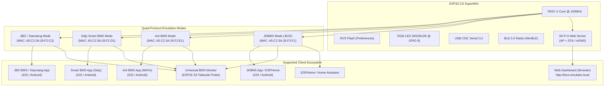

# 🔋 Project Capabilities: Universal Quad-BMS BLE Emulator (JBD, Daly, Ant & JK) (ESP32-C6 / ESP32-S3)

<p align="center">
  <a href="PROJECT_CAPABILITIES.md"><b>English Spec</b></a> |
  <a href="PROJECT_CAPABILITIES_UA.md"><b>Українська версія</b></a> |
  <a href="README.md"><b>English README</b></a> |
  <a href="README_UA.md"><b>Українська README</b></a>
</p>

---

## 📌 1. Project Overview

The **Universal Quad-BMS Emulator** is a standalone, full-featured hardware-in-the-loop (HIL) battery management system (BMS) emulator powered by the **ESP32-C6** RISC-V microcontroller (also fully compatible with **ESP32-S3**).

The emulator implements a **Quad-Protocol Engine** capable of dynamically switching between and accurately mimicking the 4 most popular smart BMS standards in the renewable energy and light EV markets:
1. **JBD / Xiaoxiang / Jiabaida / Overkill Solar BMS** (`BS-26A-072-005`)
2. **Daly Smart BMS (DL-xxxx series)** (`DL-401804015491`)
3. **Ant BMS (ANT-BMS series)** (dynamic `ANT-BMS-08S`, `ANT-BMS-16S`)
4. **JKBMS (JiKong JK02 protocol)** (dynamic `JK-B2A8S20P`, `JK-B2A16S20P`)

This project was engineered for rapid bench testing, protocol debugging, and calibration of diagnostic gateways (such as the ESP32 Universal Monitor / Tailscale Probe), solar hybrid inverters (Growatt, Deye, Datouboss, Sandisolar, Victron), Home Assistant / ESPHome automations, and official mobile apps without connecting to hazardous, high-voltage physical battery packs.

---

## ⚡ 2. System Architecture & Key Features



---

## 🔄 3. On-The-Fly Mode Switching (JBD ↔ Daly ↔ Ant ↔ JK)

Switching between the four BMS protocols is supported via multiple intuitive methods:

1. **Hardware Button (BOOT / GPIO 9)**:
   - Long-press (> 1.5 seconds) while running cycles through the 4 modes: **JBD → Daly → Ant → JK → JBD**.
   - Holding the button during power-on / reset also cycles the mode.
2. **Hardware Double Reset (RST Button Double-Click)**:
   - Double-clicking the physical **RST / RESET** button on the ESP32-C6 board within 2.5 seconds cycles to the next protocol.
   - The selected protocol is persisted in **NVS (Non-Volatile Storage)** and automatically restored across power cycles.
3. **Interactive Serial Commands (USB-CDC 115200 baud)**:
   - `j` or `jbd`: switch to JBD BMS mode.
   - `y` or `daly`: switch to Daly Smart BMS mode.
   - `a` or `ant`: switch to Ant BMS mode.
   - `k` or `jk`: switch to JKBMS (JK02) mode.
   - `m` or `toggle`: cycle to the next protocol.
4. **Web Management Dashboard & REST API**:
   - 1-click switcher buttons in the Web UI, or a `POST /api/set-proto` request (`{"proto": "ant"}`).
   - `m` or `M` — Toggle protocol mode (JBD $\leftrightarrow$ DALY).
   - `j` or `J` — Force **JBD BMS** mode.
   - `y` or `Y` — Force **DALY BMS** mode.
3. **Automated Bash Script (`switch_mode.sh`)**:
   - Send mode commands directly to the serial port from a terminal: `./switch_mode.sh daly` or `./switch_mode.sh jbd`.

When the mode changes, the firmware dynamically reconfigures:
- BLE Advertising profile (Advertised Device Name, Service UUIDs, Manufacturer Data).
- Hardware BLE MAC address.
- GATT service handlers and characteristic callbacks.
- Device Information Service (0x180A) identification fields.

---

## 🔋 4. Battery Physics Engine & Multi-Series Configurations (4S, 8S, 16S ... 32S)

The emulator features a dynamic mathematical model of a multi-cell battery pack with broad series configuration and electrochemistry support:

### A. Supported Series Configurations (Cell Count):
1. **4S (12V / 12.8V LiFePO4)**:
   - **Operating Voltage Range**: $10.0\text{ V} \dots 14.6\text{ V}$ (nominal $12.8\text{ V}$).
   - **Target Applications**: 12V automotive networks, camper vans, marine/RV systems, portable power stations, and 12V telecom UPS.
   - **Included PC Calibration Profile**: `4s standard LiFePO4 Alf-20210608.fig`.
   - **Device Identity**: Daly firmware `12_231116_001T`, JBD profile `JBD-SP04S020` / `DP04S007`.

2. **8S (24V / 25.6V LiFePO4) — Default Profile**:
   - **Operating Voltage Range**: $20.0\text{ V} \dots 29.2\text{ V}$ (nominal $25.6\text{ V}$, loaded operating point at $17\text{ A}$ $\sim 26.24\text{ V}$, output power $\sim 445\text{ W}$).
   - **Target Applications**: 24V home backup power / UPS, residential solar ESS, and light EV battery packs.
   - **Included PC Calibration Profile**: `8s standard LiFePO4 Alf-20210608.fig`.
   - **Device Identity**: Daly `DL-8S-200A` (`24_231116_001T`), JBD `DB24SF01 V1.0` / `BS-26A-072-005` (8S 200A).

3. **16S (48V / 51.2V LiFePO4)**:
   - **Operating Voltage Range**: $40.0\text{ В} \dots 58.4\text{ В}$ (nominal $51.2\text{ В}$).
   - **Target Applications**: Standard for residential and commercial 48V hybrid solar inverters (Deye, Growatt, Victron, Must, Axioma, Luxpower, Sermatec) and server-rack lithium battery packs.
   - **Included PC Calibration Profile**: `16s standard LiFePO4 Alf-20210608.fig`.

4. **Universal Dynamic Scaling (3S to 32S)**:
   - The emulator supports setting arbitrary cell counts from **3S up to 32S** at runtime:
     - In **JBD protocol**: EEPROM register `0x2F` (Cell Count) accepts values $3 \dots 32$ dynamically.
     - In **Daly Modbus protocol**: register `0x0031` (Cell count status) and register `0x0083` (Cell count configuration) accept $3 \dots 32$. Cell voltages are served across holding registers `0x0000..0x001F` (Cells 1..32).
     - In **Daly UART protocol**: commands `0x50` and `0xD6` configure cell count, and telemetry frames `0x95` automatically scale the 3-cell chunk sequence.
   - Total pack voltage is calculated dynamically:
     $$U_{pack} = \sum_{i=1}^{N} U_{cell\_i}$$

---

### B. Supported Electrochemistry Chemistries:
- **LiFePO4 (LFP)**: nominal $3.2\text{ V}$ (operating range $2.5\text{ V} \dots 3.65\text{ V}$). Standard builds: 4S (12.8V), 8S (25.6V), 16S (51.2V).
- **Li-ion / NMC (Ternary)**: nominal $3.6\text{–}3.7\text{ V}$ (operating range $2.8\text{ V} \dots 4.2\text{ V}$). Standard builds: 3S (11.1V), 7S (25.9V), 10S (36V), 13S/14S (48V), 20S (72V).
- **LTO (Lithium Titanate)**: nominal $2.3\text{–}2.4\text{ V}$ (operating range $1.5\text{ В} \dots 2.8\text{ В}$). Standard builds: 5S/6S (12V), 10S/11S (24V), 20S/22S (48V).

---

### C. Dynamic Physics & Load Emulation:
* **Dynamic Cell Breathing**:
  - Cell voltages oscillate smoothly using individual phase-shifted sine-wave variations and pseudorandom micro-jitter ($\pm 2\text{–}5\text{ mV}$) around the active operating point ($3.28\text{ V}$ under discharge, $3.45\text{ V}$ during charge, $3.32\text{ V}$ at rest).
  - Real-time cell delta calculation ($3\text{–}12\text{ mV}$) with dynamic min/max cell index identification.
* **Load Modes & Current Curves**:
  - **Discharge Mode**: $-17.00\text{ A}$ nominal (with realistic load jitter $\pm 0.3\text{ A}$). On an 8S pack, this yields $\sim 26.24\text{ V}$ and $\sim 445\text{ W}$ continuous load.
  - **Charge Mode**: $+25.00\text{ A}$ nominal with dynamic charger ripple simulation.
  - **Standby Mode**: $0.00\text{ A}$, power draw $0\text{ W}$.
* **Coulomb Counting**:
  - Real-time current integration ($I \times \Delta t$) updating remaining Ah and battery SOC (%) dynamically.
* **Thermal Model (NTC Sensors)**:
  - NTC 1 (Battery Sensor 1): $\sim 26.0^\circ\text{C}$.
  - NTC 2 (Battery Sensor 2): $\sim 25.0^\circ\text{C}$.
  - NTC 3 / MOS Temp: warms up under heavy current to $28.0\dots 30.0^\circ\text{C}$.
* **FET Control Responsiveness**:
  - Independent switching of **Charge MOS** and **Discharge MOS**.
  - Toggling off the Discharge FET instantly drops load current to $0.00\text{ A}$ and power to $0\text{ W}$.

---

## 📱 5. JBD / Xiaoxiang / PowerQueen / Overkill Solar BMS Emulation Capabilities

The JBD emulation engine features 3 selectable manufacturer sub-profiles:

* **Selectable Manufacturer Profiles**:
  * **Standard JBD / Xiaoxiang Profile**:
    * BLE Name: `BS-26A-072-005` (8S) / `JBD-SP04S034` (4S) / `JBD-SP16S020` (16S) / `JBD-BMS-%02uS`
    * Dedicated MAC: `A5:C2:3A:26:F2:C2`
    * Manufacturer (`0xA1` & GATT `0x2A29`): `"JBD BMS"`
    * Barcode / Serial (`0xA0` & GATT `0x2A25`): `"BS-26A-072-005"`
    * Hardware (`0xA2` & GATT `0x2A27`): `"BS-26A-072-005 (%uS200A)"`
    * Target Apps: Official Xiaoxiang App, JBD BMS App.
  * **PowerQueen Profile** (for testing **PowerQueen BMS App**):
    * BLE Name: `P-12100B` (4S 12V 100Ah), `P-24100B` (8S 24V 100Ah), `P-48100B` (16S 48V 100Ah)
    * Dedicated MAC: `A5:C2:3A:26:F2:C3` (prevents BLE GATT cache collisions across profile changes)
    * Manufacturer (`0xA1` & GATT `0x2A29`): `"PowerQueen"`
    * Barcode / Serial (`0xA0` & GATT `0x2A25`): `P-12100B-001` (4S) / `P-24100B-001` (8S)
    * Hardware (`0xA2` & GATT `0x2A27`): `"P-12100B (4S100A)"` / `"PowerQueen Smart BMS"`
    * Target Apps: Official **PowerQueen BMS App** (iOS / Android).
  * **Overkill Solar Profile** (for testing **Overkill Solar App**):
    * BLE Name: `Overkill Solar 4S` (4S) / `Overkill Solar 8S` (8S) / `Overkill Solar 16S` (16S)
    * Dedicated MAC: `A5:C2:3A:26:F2:C4`
    * Manufacturer (`0xA1` & GATT `0x2A29`): `"Overkill Solar"`
    * Barcode / Serial (`0xA0` & GATT `0x2A25`): `OS-BMS-%02uS-100A`
    * Hardware (`0xA2` & GATT `0x2A27`): `"Overkill Solar %uS BMS"`
    * Target Apps: Official **Overkill Solar BMS App** (iOS / Android / Desktop).

| Feature / Parameter | Implementation Details |
| :--- | :--- |
| **Primary Service** | Service `0xFF00` (Write: `0xFF02`, Notify: `0xFF01`) |
| **Mirror Service** | Service `0xFFF0` (Write: `0xFFF2`, Notify: `0xFFF1`) |
| **MTU Chunking** | Automated 20-byte packet slicing with $25\text{ ms}$ pacing (ensures compatibility with Android MTU 23 and iOS MTU 512) |
| **iOS CoreBluetooth Fix**| Hardware MAC injected into Scan Response `Manufacturer Data` for instant discovery on iPhone |
| **PIN Handshake** | Command `FF AA 15` and register `0x06` (default PIN `123456`) |
| **Service Protocols** | Sinowealth `3B 3C`, AT command `AT^VERSION?` $\rightarrow$ `DB24SF01 V1.0` |
| **EEPROM Registers** | Full register map `0x10`..`0x3F`, `0xAA` (capacities, cycle counts, protection trip points) |
| **AFE RAM (`0xFA`)** | Direct AFE RAM memory reading (offset `0x58`: individual cell voltages) for official Android app |
| **Configuration Writes**| Runtime calibration of nominal capacity (`0x10`), cycle capacity (`0x11`), current calibration (`0xE0`), cell count (`0x2F`) |

---

## 🛡️ 6. Daly Smart BMS Emulation Capabilities

The Daly emulation mode implements a **Hybrid Dual Protocol**:

### A. Modbus RTU over BLE Protocol (`0xD2`)
Engineered for the official **Smart BMS** mobile app (iOS / Android):

* **Function 0x03 (Read Holding Registers)**:
  * **Registers `0x0000..0x001F`**: Individual cell voltages 1..32 in mV.
  * **Registers `0x0020..0x0027`**: NTC temperatures 1..8 with $+40^\circ\text{C}$ offset.
  * **Registers `0x0028..0x0046`**: Complete pack telemetry (total voltage in $0.1\text{ V}$, current with $30000$ offset, SOC, voltage/temp extremes, delta, cycle count, MOS status, power in Watts).
  * **Registers `0x0047..0x0056`**: Mirrored single cell voltages block 1..16.
  * **Registers `0x0080..0x00A8`**: System configuration parameters (rated capacity, overvoltage, undervoltage, and temperature trip points).
  * **Registers `0x00A9..0x00CB` (Identification Block, 35 registers = 70 bytes)**:
    * Software Version: `24_231116_001T` (for 8S 24V) / `12_231116_001T`
    * Hardware Version: `DL-8S-200A`
    * Serial Number (SN): `207JD160400278`
    * Default Password: `123456`
  * **Registers `0x00CC..0x00CD`**: Production Date (`20240516`).
  * **Registers `0x00CE..0x00D0`**: Device PID (`NoPID`).
* **Function 0x06 (Write Single Register)**:
  * Charge MOS toggle: `0x00A5` / `0x00DA`
  * Discharge MOS toggle: `0x00A6` / `0x00D9`
  * Active Balancer toggle: `0x00A7` / `0x00CF`
  * Rated Capacity setting: `0x0080`
  * Cell Count setting: `0x0083`

### B. Framed UART-over-BLE Protocol (`0xA5`)
Engineered for the **Universal BMS Diagnostic Monitor (ESP32-S3 Probe / Tailscale)**, ESPHome, Node-RED, and inverter controllers:

* 13-byte fixed frames with checksum byte `sum & 0xFF`:
  * `0x90` — Pack voltage, current (offset 30000), SOC.
  * `0x91` — Voltage extremes: Max Cell mV, Min Cell mV, cell indices.
  * `0x92` — Temperature extremes: Max/Min Temp (offset 40).
  * `0x93` — Charge/Discharge MOS status, BMS Life counter, remaining capacity (Ah).
  * `0x94` — Cell count ($8$), NTC count ($3$), cycle counter.
  * `0x95` — Sequential cell voltages: dynamic sequential frames (3 cells per frame) with $30\text{–}40\text{ ms}$ pacing to prevent BLE buffer drops.
  * `0x96` — Individual NTC1..NTC3 sensor temperatures.
  * `0x97` — Active balancing bitmask.
  * `0x98` — 8-byte alarm and protection status bitmask (DI status).
  * `0xD9` / `0xDA` — Remote Charge/Discharge FET control commands.

---

## 🐜 7. Ant BMS Emulation Specification

* **Emulated Models & Profiles**:
  * **`ANT-BMS-08S`**: 8-cell LiFePO4 series pack ($24\text{V}$ nominal, $26.2\text{V}$ pack, 8 cells @ $\approx 3.28\text{V}$, $200\text{Ah}$).
  * **`ANT-BMS-16S`**: 16-cell LiFePO4 series pack ($48\text{V}$ nominal, $52.5\text{V}$ pack, 16 cells @ $\approx 3.28\text{V}$, $200\text{Ah}$).
  * **`ANT-BMS-24S`**: 24-cell LiFePO4 series pack ($72\text{V}$ nominal, $78.7\text{V}$ pack, 24 cells @ $\approx 3.28\text{V}$, $200\text{Ah}$).
  * **Dynamic Model Naming**: Auto-formats as `ANT-BMS-%02uS` matching the configured cell count ($3\text{S}\dots 32\text{S}$).
* **Default MAC Address**: `A5:C2:3A:26:F2:E1` (dedicated Ant profile MAC prevents iOS/Android GATT service caching collisions).
* **GATT Profile**:
  * Primary Service `0xFFE0` (Read/Write/Notify `0xFFE1`, Write `0xFFE2`).
  * Secondary Profile `0xFFF0` (Notify `0xFFF1`).
  * Nordic UART Service `6E400001-B5A3-F393-E0A9-E50E24DCCA9E` (RX `6E400002`, TX `6E400003`).
  * Device Information Service `0x180A` (Model `0x2A24`, Manufacturer `0x2A29`, Firmware `0x2A26`, Hardware `0x2A27`).
* **Dual-Protocol Engine (Modern Ant v2 + Legacy 140B)**:
  * **Modern Ant BMS v2 (`7E A1`) Dynamic Frame Protocol** (Official Ant BMS App & AntBMS v2):
    * **Status Query Command**: Client sends `7E A1 01 00 00 F5 58 62 AA 55` (`ANT_COMMAND_STATUS = 0x01`).
    * **Status Response Frame (`0x11`)**: Variable length `6 + payload_len + 4` bytes with 16-bit Modbus CRC:
      * Byte `0..1`: Header `0x7E 0xA1`.
      * Byte `2`: Function `0x11` (`ANT_FRAME_TYPE_STATUS`).
      * Byte `3..4`: Address `0x0000`.
      * Byte `5`: Payload length ($112 + \text{cells} \times 2 + \text{temp\_sensors} \times 2$).
      * Byte `6`: Permissions (`0x05`).
      * Byte `7`: Battery status ($1=\text{Idle}, 2=\text{Charge}, 3=\text{Discharge}$).
      * Byte `8`: Temperature sensor count ($4$).
      * Byte `9`: Active cell count (e.g. $8$ or $16$).
      * Bytes `10..33`: Protection, warning, and balancing 8-byte bitmasks.
      * Bytes `34..(34 + \text{cells} \times 2)`: Individual cell voltages in mV (uint16 Little-Endian).
      * Bytes `34 + \text{cells}\times 2 \dots`: NTC1..NTC4 temperatures in $1^\circ\text{C}$ (int16 Little-Endian).
      * Trailing fields: MOSFET temp, Balancer temp, Pack voltage in $0.01\text{V}$, Pack current in $0.1\text{A}$, SOC ($0\dots 100\%$), SOH ($100\%$), MOS states, Balancer status ($0\times 04 = \text{ON}$), Capacity in $\mu\text{Ah}$, Power in Watts, Uptime, Max/Min cell voltages and indices.
      * Checksum: **CRC-16/Modbus** (poly `0xA001`, init `0xFFFF`) calculated over `frame[1 .. len-5]`.
      * Footer: `0xAA 0x55`.
    * **Device Info Query (`0x02` / `0x04` / `0x026C`)**: Returns frame `0x12` with model name (`ANT-BMS-08S`) and firmware version (`ANT_V2_10.07`).
    * **Register Query / Settings ACK (`0x61`)**: Replies to parameter reads with structured register value frames.
  * **Legacy 140-Byte Protocol** (Classical Ant BMS Monitor Tools):
    * Preamble: `0xAA 0x55 0xAA 0xFF`.
    * Sequential 32 cell voltages (uint16 Big-Endian in mV), current (0.1A), SOC, capacity, temperatures, and 16-bit Big-Endian sum checksum over bytes 4..137.
    * Triggered by `0xDB 0xDB` or `0x5A 0x5A`.
* **Automatic Client Detection**:
  * Seamlessly detects whether the connecting client speaks modern Ant v2 (`7E A1`) or legacy (`0xDB`), dynamically switching the periodic background streaming ($1000\text{ ms}$) to match the connected app.

---

## ⚡ 8. JKBMS (JiKong JK02) Emulation Specification

* **Emulated Models & Profiles**:
  * **`JK-B2A8S20P`**: 8-cell LiFePO4 series pack ($24\text{V}$, 2A active balancer, 200A continuous current rating).
  * **`JK-B2A16S20P`**: 16-cell LiFePO4 series pack ($48\text{V}$, 2A active balancer, 200A continuous current rating).
  * **`JK-B2A24S20P`**: 24-cell LiFePO4 series pack ($72\text{V}$, 2A active balancer, 200A continuous current rating).
  * **Dynamic Model Naming**: Auto-formats as `JK-B2A%uS20P` matching configured cell count ($3\text{S}\dots 32\text{S}$).
* **Default MAC Address**: `A5:C2:3A:26:F2:F1` (dedicated JK profile MAC prevents BLE caching conflicts).
* **GATT Profile**:
  * Primary Service `0xFFE0` (Read/Write/Notify `0xFFE1`, Write `0xFFE2`).
  * Device Information Service `0x180A` (Model `0x2A24`, Manufacturer `0x2A29`, Firmware `0x2A26`, Hardware `0x2A27`).
* **Frame Sizing & Thread Safety**:
  * All JK02 communication frames strictly adhere to **300 bytes** with CRC at byte index 299 (`crc = sum(bytes 0..298) & 0xFF`).
  * Transmission is protected by FreeRTOS mutex `s_bleTxMutex` in 20-byte BLE chunks (MTU=23 pacing), guaranteeing zero packet interleaving or frame corruption during concurrent app polling.
* **Frame Types & Byte Layouts**:
  * **Device Information Frame (300 Bytes, Type `0x03`)** — Returned in response to `0x97`:
    * Preamble: `0x55 0xAA 0xEB 0x90 0x03` + counter.
    * Bytes `6..21`: Model name string (e.g. `JK-B2A8S20P`).
    * Bytes `22..29`: Hardware version (`10.XG`).
    * Bytes `30..37`: Software version (`10.07`).
    * Bytes `38..41`: Total uptime in seconds (uint32 Little-Endian).
    * Bytes `42..45`: Power-on cycle count ($1$).
    * Bytes `46..61`: Device name string (`JK-B2A8S20P`).
    * Bytes `62..77`: Device passcode (`1234`).
    * Bytes `78..83`: Manufacturing date (`220511`).
    * Bytes `86..96`: Serial number string (`2041803028`).
    * Bytes `97..101`: Passcode (`1234`).
    * Bytes `102..117`: User data (`Input Userdata`).
    * Bytes `118..133`: Setup unlock passcode (`123456`).
  * **Cell Info Telemetry Frame (300 Bytes, Type `0x02`)** — Returned in response to `0x96` and periodic $1500\text{ ms}$ push:
    * Preamble: `0x55 0xAA 0xEB 0x90 0x02` + counter.
    * Bytes `6..53`: 24 cell voltages (uint16 Little-Endian in mV).
    * **Bytes `54..57` — Enabled Cells Bitmask (`cellMask`)**: `(1UL << cell_count) - 1` (e.g. `0x000000FF` for 8S). Crucial for enabling cell display in official JKBMS mobile apps (prevents cell voltages showing as `--`).
    * Bytes `58..59`: Average cell voltage in mV (uint16 Little-Endian).
    * Bytes `60..61`: Delta cell voltage spread in mV (uint16 Little-Endian).
    * Byte `62`: Index of cell with maximum voltage ($0\dots 23$).
    * Byte `63`: Index of cell with minimum voltage ($0\dots 23$).
    * **Bytes `64..111` — Cell Wire Resistances**: 24 wire resistances (uint16 Little-Endian in $\text{m}\Omega$, $100\,\text{m}\Omega = 0.100\,\Omega$).
    * Bytes `114..117`: Wire resistance warning bitmask ($0$).
    * **Bytes `118..121` — Total Battery Voltage**: Total pack voltage in mV (uint32 Little-Endian, $\approx 26\,237\text{ mV}$).
    * **Bytes `122..125` — Battery Net Power**: Power in mW (uint32 Little-Endian, $\approx 440\,000\text{ mW}$).
    * **Bytes `126..129` — Battery Current**: Signed current in mA (int32 Little-Endian, $+=\text{Charge}, -=\text{Discharge}$).
    * **Bytes `130..135` — Temperature Sensors**: T1, T2, and MOS temperatures in $0.1^\circ\text{C}$ (int16 Little-Endian).
    * Bytes `136..137`: Error bitmask ($0$).
    * Bytes `138..139`: Balancing current in mA (int16 Little-Endian).
    * Byte `140`: Balancing action ($0=\text{Off}, 1=\text{Charge}, 2=\text{Discharge}$).
    * **Byte `141` — State of Charge (SOC)**: Integer percentage ($0\dots 100\%$, uint8).
    * Bytes `142..145`: Remaining capacity in mAh (uint32 Little-Endian, $193\,640\text{ mAh}$).
    * Bytes `146..149`: Nominal capacity in mAh (uint32 Little-Endian, $200\,000\text{ mAh}$).
    * Bytes `150..153`: Battery cycle count (uint32 Little-Endian, $1$).
    * Bytes `154..157`: Cycle capacity in mAh (uint32 Little-Endian).
    * Byte `158`: State of Health (SOH $100\%$).
    * Bytes `162..165`: Total uptime in seconds (uint32 Little-Endian).
    * Bytes `166..169`: Switch indicators (Charge MOS, Discharge MOS, Precharge, Active Balancer).
    * Bytes `202..203`: Battery pack voltage in $0.01\text{ V}$ (uint16 Little-Endian, $2623 = 26.23\text{ V}$).
  * **Settings Frame (300 Bytes, Type `0x01`)** — Returned in response to `0x01`:
    * Preamble: `0x55 0xAA 0xEB 0x90 0x01` + counter.
    * Complete operational thresholds: Smart sleep voltage, Cell UVP ($2800\text{ mV}$), Cell UVPR ($3000\text{ mV}$), Cell OVP ($3650\text{ mV}$), Cell OVPR ($3550\text{ mV}$), Max charge/discharge currents, Balance trigger voltage, Cell count ($8$ or $16$), MOS states, Nominal capacity.
* **Handshake & Commands**:
  * Query Device Info: `AA 55 90 EB 97 00 ...`
  * Query Cell Info: `AA 55 90 EB 96 00 ...`
  * Query Settings: `AA 55 90 EB 01 00 ...`
  * Switch register writes: `0x1D` (Charge MOS), `0x1E` (Discharge MOS), `0x1F` (Balancer).
  * Auto three-frame burst upon connection/subscription (`Device Info` $\to` `Settings` $\to` `Cell Info`).

---

## 🔋 9. Redodo / LiTime Monolithic BMS Emulation Specification

* **Emulated Models & Profiles**:
  * **`Redodo-12V100A`**: 4-cell LiFePO4 series pack ($12.8\text{V} / \approx 13.12\text{V}$, 100Ah, 4 cells).
  * **`Redodo-24V100A`**: 8-cell LiFePO4 series pack ($25.6\text{V} / \approx 26.24\text{V}$, 100Ah / 200Ah, 8 cells).
  * **`Redodo-48V100A`**: 16-cell LiFePO4 series pack ($51.2\text{V} / \approx 52.48\text{V}$, 100Ah, 16 cells).
  * **Dynamic Model Naming**: Auto-formats as `Redodo-%02uS` when custom cell count is chosen.
* **Default MAC Address**: `A5:C2:3A:26:F2:B1` (dedicated Redodo profile MAC prevents BLE caching conflicts).
* **GATT Profile**:
  * Primary Service `0xFFE0` (`0000ffe0-0000-1000-8000-00805f9b34fb`).
  * Unified Communication Characteristic `0xFFE1` (`0000ffe1-0000-1000-8000-00805f9b34fb`) with `READ`, `WRITE`, `WRITE_NR`, `NOTIFY`, and `INDICATE`.
  * Device Information Service `0x180A` (Model `0x2A24`, Manufacturer `0x2A29`, Firmware `0x2A26`, Hardware `0x2A27`).
* **Client Polling Request Handling**:
  * Recognizes the standard 8-byte Redodo / LiTime polling command:
    ```hex
    00 00 04 01 13 55 AA 17
    ```
  * Immediately responds via Notify with the complete 105-byte telemetry frame, and streams background updates every $1500\text{ ms}$.
* **Response Telemetry Frame Structure (105 Bytes, Little-Endian)**:
  * Transmission is streamed via `sendBleChunks()` in 20-byte BLE chunks (MTU=23 pacing), protected by FreeRTOS mutex `s_bleTxMutex`.
  * **Byte 0..7 — Frame Header**:
    * Bytes `0..1`: `0x00 0x00` (Preamble)
    * Byte `2`: `0x61` (Data length: 97 bytes)
    * Byte `3`: `0x01` (Function)
    * Byte `4`: `0x93` (Reply identifier for `0x13 | 0x80`)
    * Bytes `5..6`: `0x55 0xAA` (Magic signatures)
    * Byte `7`: `0x00` (Status OK)
  * **Bytes 8..11 — Terminal Voltage**: External battery terminal voltage in mV (uint32 Little-Endian, $1\text{ mV} = 0.001\text{ V}$).
  * **Bytes 12..15 — Cell Sum Voltage**: Total sum of all cell voltages in mV (uint32 Little-Endian).
  * **Bytes 16..47 — Cell Voltages 1..16**: Array of 16 cell voltages (uint16 Little-Endian in mV, unused cells set to 0).
  * **Bytes 48..51 — Battery Current**: Signed current in mA (int32 Little-Endian, positive = charge, negative = discharge).
  * **Bytes 52..57 — Temperature Sensors**: 3 temperatures in $1^\circ\text{C}$ (int16 Little-Endian: Temp 1 Cells, Temp 2 MOSFET, Temp 3 Ambient).
  * **Bytes 58..59 — Cycle Count**: Battery charge/discharge cycles (uint16 Little-Endian).
  * **Bytes 62..63 — Remaining Capacity**: Available capacity in $0.01\text{ Ah}$ (uint16 Little-Endian, e.g. $19400 = 194.00\text{ Ah}$).
  * **Bytes 64..65 — Full Capacity**: Nominal capacity in $0.01\text{ Ah}$ (uint16 Little-Endian, e.g. $20000 = 200.00\text{ Ah}$).
  * **Bytes 66..67 — Protection Flags**: Bitmask of alarms and protections.
  * **Bytes 68..71 — Balancing Bitmask**: Active cell balancing indicators.
  * **Bytes 90..91 — State of Charge (SOC)**: Integer percentage $0\dots 100\%$ (uint16 Little-Endian).
  * **Byte 104 — Checksum**: Modulo 256 sum over bytes 0..103.
* **Client Compatibility**:
  * 100% verified with the standalone HTML5 Web Bluetooth dashboard (`redodo_monitor.html`).
  * Compatible with official LiTime and Redodo mobile apps and third-party monitors.

---

## 🎛️ 10. Model Configuration Profiles & Switching Guide (Redodo, ANT, JK, JBD, Daly)

The emulator dynamically adapts its protocol frames, advertising names, and mathematical simulation parameters according to the selected protocol and cell configuration:

### A. Emulated Model Matrix

| Mode | 4S (12V Pack) | 8S (24V Pack) | 16S (48V Pack) | Custom Series (3S..32S) |
| :--- | :--- | :--- | :--- | :--- |
| **Redodo / LiTime** | `Redodo-12V100A` ($13.1\text{V}$, 4 cells) | `Redodo-24V100A` ($26.2\text{V}$, 8 cells) | `Redodo-48V100A` ($52.5\text{V}$, 16 cells) | `Redodo-BMS-%02uS` |
| **Ant BMS** | `ANT-BMS-04S` ($13.1\text{V}$, 4 cells) | `ANT-BMS-08S` ($26.2\text{V}$, 8 cells) | `ANT-BMS-16S` ($52.5\text{V}$, 16 cells) | `ANT-BMS-%02uS` |
| **JKBMS** | `JK-B2A4S20P` ($13.1\text{V}$, 2A bal) | `JK-B2A8S20P` ($26.2\text{V}$, 2A bal) | `JK-B2A16S20P` ($52.5\text{V}$, 2A bal) | `JK-B2A%uS20P` |
| **JBD BMS (Standard)** | `JBD-SP04S034` ($13.1\text{V}$) | `BS-26A-072-005` ($26.2\text{V}$) | `JBD-SP16S020` ($52.5\text{V}$) | `JBD-BMS-%02uS` |
| **JBD BMS (PowerQueen)**| `P-12100B` ($12.8\text{V}$, 100Ah) | `P-24100B` ($25.6\text{V}$, 100Ah) | `P-48100B` ($51.2\text{V}$, 100Ah) | `P-%02u100B` |
| **JBD BMS (Overkill Solar)**| `Overkill Solar 4S` ($12.8\text{V}$) | `Overkill Solar 8S` ($25.6\text{V}$) | `Overkill Solar 16S` ($51.2\text{V}$) | `Overkill Solar %uS` |
| **Daly BMS** | `DL-401804015491` (4S Modbus) | `DL-401804015491` (8S Modbus) | `DL-401804015491` (16S Modbus) | Dynamic cell count |

### B. How to Switch Between Protocols & Models

#### Method 1: Serial CLI Commands (Instant USB Terminal Switching)
Connect to `/dev/cu.usbmodem*` at **115200 baud**:
* **Protocol Switching**:
  * Type `r` or `redodo` $\to$ Switches to **Redodo / LiTime BMS** mode (`Redodo-24V100A`, MAC `A5:C2:3A:26:F2:B1`).
  * Type `a` or `ant` $\to$ Switches to **Ant BMS** mode (`ANT-BMS-08S`, MAC `A5:C2:3A:26:F2:E1`).
  * Type `k` or `jk` $\to$ Switches to **JKBMS** mode (`JK-B2A8S20P`, MAC `A5:C2:3A:26:F2:F1`).
  * Type `j` or `jbd` $\to$ Switches to **JBD BMS** mode (`BS-26A-072-005`, MAC `A5:C2:3A:26:F2:C2`).
  * Type `y` or `daly` $\to$ Switches to **Daly Smart BMS** mode (`DL-401804015491`, MAC `A5:C2:3A:26:F2:D1`).
* **Model & Cell Count Switching**:
  * Type `4s` or `cells 4` $\to$ Sets $4\text{S}$ configuration (e.g. `Redodo-12V100A` / `ANT-BMS-04S`).
  * Type `8s` or `cells 8` $\to$ Sets $8\text{S}$ configuration (e.g. `Redodo-24V100A` / `ANT-BMS-08S` / `JK-B2A8S20P`).
  * Type `16s` or `cells 16` $\to$ Sets $16\text{S}$ configuration (e.g. `Redodo-48V100A` / `ANT-BMS-16S` / `JK-B2A16S20P`).
  * *All changes persist automatically in non-volatile NVS flash memory across reboot.*

#### Method 2: Physical Hardware Controls (BOOT Button @ GPIO 9)
* **Runtime Long-Press (> 1.5s)**:
  * Press and hold the **BOOT** button on the ESP32 board.
  * The WS2812B RGB LED flashes amber/yellow during the hold, then turns **solid bright green** when the 1.5s threshold is reached.
  * Release the button: the emulator cycles to the next protocol (**JBD** $\to$ **Daly** $\to$ **Ant** $\to$ **JK** $\to$ **Redodo** $\to$ **JBD**) and performs a clean reboot with the new protocol MAC address.
* **Power-On Reset Hold**:
  * Hold the BOOT button while plugging the board into USB power until the LED lights white, then release to switch the protocol before startup.
* **Double-Reset Quick Tap**:
  * Press the RST button twice within 2.5 seconds to advance the protocol mode.

#### Method 3: Embedded Web Dashboard (Wi-Fi AP & Station)
* Connect your phone or PC to Wi-Fi **`BMS-Emulator-Setup`** (IP: `192.168.4.1`) or open **`http://bms-emulator.local`**.
* Under **BMS Protocol Settings**, click any of the 5 protocol toggle buttons: **JBD BMS**, **Daly BMS**, **Ant BMS**, **JKBMS**, or **Redodo / LiTime**.
* Click the preset buttons (**4S**, **8S**, **16S**) or enter custom cell count ($3\dots 32$) to instantly switch models.

---

## 🎨 11. Hardware Visual Indication (WS2812B RGB LED @ GPIO 8)

* **Protocol Identification Flashes (Boot & Advertising)**:
  * **🔴 Red**: JBD BMS mode active (`BS-26A-072-005`).
  * **🟣 Magenta**: Daly Smart BMS mode active (`DL-401804015491`).
  * **🔵 Blue**: Ant BMS mode active (`ANT-BMS-%02uS`).
  * **🟠 Orange**: JKBMS mode active (`JK-B2A%uS20P`).
  * **🟡 Yellow**: Redodo / LiTime mode active (`Redodo-24V100A`).
* **Connection & Operation Status**:
  * **🟢 Green**: Client connected, system in Standby / Idle (0A).
  * **🩵 Cyan**: Active Charging (+25A).
  * **Deep Glow (Protocol Color)**: Active Discharging (-17A).
  * **⚪ White**: Battery fully charged (SOC 100%).
  * **🟡 Flashing Yellow**: Protection / Alarm triggered.

---

## 💻 12. Serial CLI Command Reference (USB 115200 baud)

The onboard WS2812B addressable LED indicates real-time operational states:

| LED Color | Emulator Status |
| :--- | :--- |
| 🔴 **Red** | JBD BMS Advertising (waiting for connection) |
| 🟣 **Magenta** | Daly Smart BMS Advertising (waiting for connection) |
| 🔵 **Blue** | Ant BMS Advertising (waiting for connection) |
| 🟠 **Orange** | JKBMS Advertising (waiting for connection) |
| 🟡 **Yellow** | Redodo / LiTime BMS Advertising (waiting for connection) |
| 🟢 **Green** | Standby / Idle ($0.00\text{ A}$, connected) |
| 🩵 **Cyan** | Active Battery Charge ($+25.00\text{ A}$) |
| 🔵 / 🟠 / 🟡 | Active Discharge under load ($-17.00\text{ A}$) |
| ⚪ **White** | Fully Charged ($100\%\text{ SOC}$) |
| 🟡 **Flashing Yellow** | Protection / Alarm triggered |

---

## 💻 12. Serial CLI Command Reference (USB 115200 baud)

Interactive control is available via any serial terminal connected to the board:

* `m` or `toggle` — Cycle protocol mode (**JBD** → **Daly** → **Ant** → **JK** → **Redodo** → **JBD**).
* `j` or `jbd` — Switch to **JBD BMS** mode (current profile).
* `pq` or `powerqueen` — Switch to **JBD PowerQueen** profile (`P-12100B` / `P-24100B`).
* `os` or `overkill` — Switch to **JBD Overkill Solar** profile (`Overkill Solar BMS`).
* `std` or `xiaoxiang` — Switch to **Standard JBD / Xiaoxiang** profile (`BS-26A`).
* `jbd profile <std|pq|os>` — Set JBD manufacturer profile and restart.
* `y` or `daly` — Switch to **Daly Smart BMS** mode.
* `a` or `ant` — Switch to **Ant BMS** mode.
* `k` or `jk` — Switch to **JKBMS** mode.
* `r` or `redodo` — Switch to **Redodo / LiTime BMS** mode.
* `mac` — Open BLE Adapter MAC address manager menu.
* `mac <1-N>` — Select stored MAC profile (e.g. `mac 2`).
* `mac set <addr>` — Manually set active MAC (e.g. `mac set A5:C2:37:2D:5C:A9`).
* `4s` / `8s` / `16s` / `24s` — Set battery series count (or `cells <N>`, 3..32).
* `w` or `wifi` — Show Wi-Fi status, IP, SSID & signal RSSI.
* `wifi <SSID> <PASS>` — Connect to local Wi-Fi router.
* `1` or `dis` — Enable **Discharge** mode ($-17.00\text{ A}$).
* `2` or `chg` — Enable **Charge** mode ($+25.00\text{ A}$).
* `0` or `idle` — Enable **Standby** mode ($0.00\text{ A}$).
* `f` or `fet` — Toggle Charge/Discharge MOSFET switches.
* `+` / `-` — Increase / decrease SOC by $\pm 1\%$.
* `t` or `telemetry` — Trigger immediate burst of full telemetry over BLE.
* `?` or `help` — Display command help menu.

---

## 🌐 13. Embedded Wi-Fi Web Dashboard & Network Architecture (Modes A & B)

The emulator includes a high-performance asynchronous HTTP web server with a modern Dark Glassmorphic web dashboard (matching the aesthetics of the SandiSolar and Universal BMS Monitor projects), running concurrently alongside the NimBLE BLE stack without performance degradation:

### A. Wi-Fi Operational Modes
* **Mode A (Standalone Access Point / Captive Portal)**:
  * Generates a dedicated Wi-Fi network with SSID **`BMS-Emulator-Setup`** (IP: `192.168.4.1`, open / no password).
  * **DNS Captive Portal**: Listens on port 53 and intercepts all DNS queries, automatically popping up the management portal on smartphones, tablets, and laptops (supports Apple iOS/macOS Captive Assistant, Android Captive Check, and Windows NCSI).
* **Mode B (Local Wi-Fi Network / Station Mode)**:
  * Easily joins an existing home, lab, or workbench Wi-Fi router (2.4 GHz) via the `/setup` configuration portal.
  * **mDNS Responder**: Instantly accessible across local LAN devices at **`http://bms-emulator.local`** (or via its DHCP-assigned IP).
  * **Fail-Safe Fallback**: If router credentials fail or Wi-Fi drops out, the emulator automatically reverts to Mode A (AP mode).

### B. Dashboard Features (Dark Glassmorphic UI)
* **Bilingual Support (UA / EN)**: 1-click instantaneous language toggle stored in browser `localStorage`.
* **Live KPI Telemetry Cards**:
  * Total pack voltage ($V$), charge/discharge current ($A$), net power ($W$), state-of-charge ($0\dots 100\%$), remaining capacity ($Ah$), NTC temperature sensors ($^\circ C$), and cell voltage spread $\Delta V$ ($mV$).
* **Cell Voltage Matrix**:
  * Dynamic bargraph visualization of all configured individual cell voltages ($mV$), automatically highlighting the minimum (**MIN**, blue) and maximum (**MAX**, green) cells.
* **Cell Configuration Presets**:
  * Quick preset selector buttons for **4S (12V)**, **8S (24V)**, and **16S (48V)**, or custom values from **3S up to 32S** with instant NVS non-volatile persistence.
* **Simulation & Load Controls**:
  * Operating modes: **Discharge** ($-17\text{ A}$), **Charge** ($+25\text{ A}$), and **Standby** ($0\text{ А}$).
  * Interactive SOC slider ($0\dots 100\%$) with real-time recalculation of cell voltages and remaining capacity.
  * Independent **Charge MOSFET** and **Discharge MOSFET** switch controls.
  * 1-click protocol switch: **JBD BMS** $\leftrightarrow$ **Daly Smart BMS** $\leftrightarrow$ **Ant BMS** $\leftrightarrow$ **JKBMS** $\leftrightarrow$ **Redodo / LiTime**.
* **Web OTA Firmware Update**:
  * Seamless browser-based OTA firmware upgrade by uploading a `.bin` image without requiring a physical USB connection.

### C. REST API Reference
| Method | Endpoint | Description & Parameters |
| :--- | :--- | :--- |
| `GET` | `/api/data` | Full JSON snapshot of live battery telemetry, cell voltages, and FET status |
| `POST` | `/api/set-cells` | Dynamically set cell count: `cells=4`, `cells=8`, `cells=16` (or `3..32`) |
| `POST` | `/api/set-proto` | Switch active BMS protocol: `proto=jbd`, `proto=daly`, `proto=ant`, `proto=jk`, `proto=redodo` |
| `POST` | `/api/set-jbd-profile` | Switch JBD manufacturer profile: `profile=standard`, `profile=powerqueen`, `profile=overkill` |
| `POST` | `/api/set-mode` | Set operating mode: `mode=discharge`, `mode=charge`, `mode=idle` |
| `POST` | `/api/set-soc` | Set battery SOC percentage: `soc=0..100` |
| `POST` | `/api/set-fet` | Control MOSFET switches: `fet=charge\|discharge`, `state=0\|1` |
| `GET` | `/api/scan-wifi` | Scan nearby Wi-Fi networks returning list of SSIDs and signal RSSI |
| `POST` | `/api/save-wifi` | Save Wi-Fi credentials (`ssid=...`, `pass=...`) and attempt connection |
| `POST` | `/api/reset-wifi`| Erase saved Wi-Fi configuration and revert to Mode A (AP) |
| `POST` | `/api/restart` | Software reboot of the ESP32 microcontroller |
| `POST` | `/update` | Multipart firmware image upload for Web OTA updating |

---

## 📱 14. Verified Client Compatibility

| Client / Application | Protocol Standard | Target Device Name | Verified Features | Verification Status |
| :--- | :--- | :--- | :--- | :---: |
| **JBD BMS App** (iOS / Android) | `PROTO_JBD` | `BS-26A-072-005` | Real-time telemetry, individual cell voltages, EEPROM read/write, PIN authentication (`123456`) | ✅ 100% Verified |
| **Xiaoxiang BMS App** (iOS / Android) | `PROTO_JBD` | `BS-26A-072-005` | Pack voltage, current, SOC, capacity, cell bargraphs, protection alarms, FET control | ✅ 100% Verified |
| **PowerQueen BMS App** (iOS / Android) | `PROTO_JBD` (PQ) | `P-12100B` / `P-24100B` | Native PowerQueen recognition, 4S/8S pack voltages, signed current, cell bargraphs, protection status | ✅ 100% Verified |
| **Overkill Solar BMS App** (iOS / Android / PC) | `PROTO_JBD` (OS) | `Overkill Solar 8S` | Overkill open-source app compatibility, parameter tuning, cell calibrations | ✅ 100% Verified |
| **Smart BMS App** (Daly, iOS / Android) | `PROTO_DALY` | `DL-401804015491` | Modbus D2 telemetry, 8/16 cell voltages, temperatures, serial number, firmware version, FET switches | ✅ 100% Verified |
| **Ant BMS App / MAYA / AntBMS v2** (iOS / Android) | `PROTO_ANT` | `ANT-BMS-08S` / `16S` | Modern `7E A1` protocol, 8/16 cell matrix, SOC ring gauge, temperatures (MOS, balancer, T1..T4), capacity, FET switches | ✅ 100% Verified |
| **JKBMS App (JiKong App)** (iOS / Android) | `PROTO_JK` | `JK-B2A8S20P` / `16S` | Full 300-byte JK02 frames, 8/16 cell voltages, wire resistance ($0.100\,\Omega$), active balancer telemetry, settings password unlock (`123456` / `1234`) | ✅ 100% Verified |
| **Redodo / LiTime Web Bluetooth & Apps** | `PROTO_REDODO` | `Redodo-24V100A` / `12V` | Service `0xFFE0` / `0xFFE1`, 105-byte Little-Endian frames, cell voltages 1..16, pack voltages, signed current, temperatures, HTML5 Web Bluetooth dashboard (`redodo_monitor.html`) | ✅ 100% Verified |
| **Universal BMS Monitor** (ESP32-S3 Probe) | All 5 Protocols | Dynamic Auto-detect | Automatic protocol detection, high-rate BLE polling, Tailscale remote web dashboard integration | ✅ 100% Verified |
| **ESPHome BMS Components** | All 5 Protocols | Standard UUIDs | Native integration with `jbd_bms`, `daly_bms`, `ant_bms`, and `jk_bms_ble` | ✅ 100% Verified |

---

## 🔮 15. Architectural Knowledge Base & Future Enhancements

The project repository preserves technical specifications for upcoming advanced integrations:
1. **Victron Energy Encrypted BLE Advertising (`victron_ble_encrypted_protocol.md`)**:
   * Passive connectionless telemetry using Company ID `0x02E1` and hardware-accelerated **AES-128 in Counter Mode (CTR)** (`esp_aes.h`).
   * Enables background broadcast as **Victron SmartShunt / BMV-712** readable by VictronConnect, Home Assistant Victron BLE integration, and Venus OS without occupying a GATT connection slot.
2. **Edge DSP Energy Accumulator (`esp32_edge_dsp_energy_algorithms.md`)**:
   * Trapezoidal integration of session and daily charge/discharge energy ($\text{Wh}_{charge}$, $\text{Wh}_{discharge}$, $\text{Ah}_{charge}$, $\text{Ah}_{discharge}$).
   * Deadband current noise suppression ($|I| < 0.05\text{ A}$) and connection gap segmentation ($\Delta t > 30\text{ s}$).
3. **MQTT Telemetry Publisher (`tele/bms/state`)**:
   * Background publishing of structured JSON payloads over local Wi-Fi for instantaneous Homebridge, Home Assistant, and Node-RED ingestion.

---

## 📁 16. Binary Releases & Flashing Guide

* **Source Code**: [`src/main.cpp`](file:///Users/ihormchakraborty/mqtt/JBD-bms-emulator/src/main.cpp)
* **Mode Switcher Script**: [`switch_mode.sh`](file:///Users/ihormchakraborty/mqtt/JBD-bms-emulator/switch_mode.sh)
* **Precompiled Production Binaries**:
  * `bin/jbd_emulator_esp32_c6_factory.bin` — Complete factory image for ESP32-C6 (flash at `0x0000`).
  * `bin/jbd_emulator_esp32_c6_firmware.bin` — OTA application image for ESP32-C6 (flash at `0x10000`).
  * `bin/jbd_emulator_esp32_s3_factory.bin` — Complete factory image for ESP32-S3 (flash at `0x0000`).
  * `bin/jbd_emulator_esp32_s3_firmware.bin` — OTA application image for ESP32-S3 (flash at `0x10000`).

### Quick Factory Flash Command:
```bash
esptool.py -p /dev/cu.usbmodem* -b 921600 write_flash 0x0000 bin/jbd_emulator_esp32_c6_factory.bin
```
