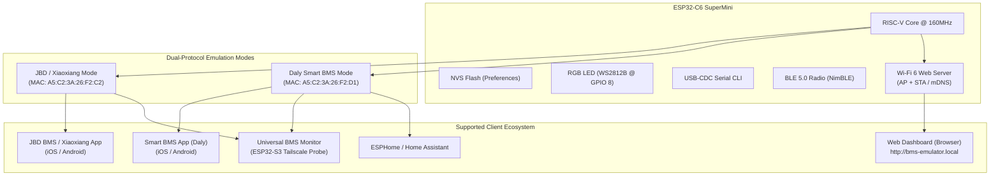

# 🔋 Project Capabilities: JBD & Daly BMS BLE Emulator (ESP32-C6 / ESP32-S3)

<p align="center">
  <a href="PROJECT_CAPABILITIES.md"><b>English Spec</b></a> |
  <a href="PROJECT_CAPABILITIES_UA.md"><b>Українська версія</b></a> |
  <a href="README.md"><b>English README</b></a> |
  <a href="README_UA.md"><b>Українська README</b></a>
</p>

---

## 📌 1. Project Overview

The **JBD & Daly BMS Emulator** is a standalone, full-featured hardware-in-the-loop (HIL) battery management system (BMS) emulator powered by the **ESP32-C6** RISC-V microcontroller (also fully compatible with **ESP32-S3**).

The emulator implements a **Dual-Protocol Engine** capable of dynamically switching between and accurately mimicking the two most popular smart BMS standards in the renewable energy and light EV markets:
1. **JBD / Xiaoxiang / Jiabaida / Overkill Solar BMS**
2. **Daly Smart BMS (DL-xxxx series)**

This project was engineered for rapid bench testing, protocol debugging, and calibration of diagnostic gateways (such as the ESP32 Universal Monitor / Tailscale Probe), solar hybrid inverters (Growatt, Deye, Datouboss, Sandisolar, Victron), Home Assistant / ESPHome automations, and official mobile apps without connecting to hazardous, high-voltage physical battery packs.

---

## ⚡ 2. System Architecture & Key Features



---

## 🔄 3. On-The-Fly Mode Switching (JBD ↔ Daly)

Switching between JBD and Daly protocols is supported via three methods:

1. **Hardware Double Reset (RST Button Double-Click)**:
   - Double-clicking the physical **RST / RESET** button on the ESP32-C6 board within 1.5 seconds instantly toggles the active protocol.
   - The selected protocol mode is persisted in **NVS (Non-Volatile Storage)** and automatically restored across power cycles.
2. **Interactive Serial Commands (USB-CDC 115200 baud)**:
   - `m` or `M` — Toggle protocol mode (JBD $\leftrightarrow$ DALY).
   - `j` or `J` — Force **JBD BMS** mode.
   - `y` or `Y` — Force **DALY BMS** mode.
3. **Automated Bash Script (`switch_mode.sh`)**:
   - Send mode commands directly to the serial port from a terminal: `./switch_mode.sh daly` or `./switch_mode.sh jbd`.

When the mode changes, the firmware dynamically reconfigures:
- BLE Advertising profile (Advertised Device Name, Service UUIDs, Manufacturer Data).
- Hardware BLE MAC address.
- GATT service handlers and characteristic callbacks.
- Device Information Service (0x180A) identification fields.

---

## 🔋 4. Battery Physics Engine & Multi-Series Configurations (4S, 8S, 16S ... 32S)

The emulator features a dynamic mathematical model of a multi-cell battery pack with broad series configuration and electrochemistry support:

### A. Supported Series Configurations (Cell Count):
1. **4S (12V / 12.8V LiFePO4)**:
   - **Operating Voltage Range**: $10.0\text{ V} \dots 14.6\text{ V}$ (nominal $12.8\text{ V}$).
   - **Target Applications**: 12V automotive networks, camper vans, marine/RV systems, portable power stations, and 12V telecom UPS.
   - **Included PC Calibration Profile**: `4s standard LiFePO4 Alf-20210608.fig`.
   - **Device Identity**: Daly firmware `12_231116_001T`, JBD profile `JBD-SP04S020` / `DP04S007`.

2. **8S (24V / 25.6V LiFePO4) — Default Profile**:
   - **Operating Voltage Range**: $20.0\text{ V} \dots 29.2\text{ V}$ (nominal $25.6\text{ V}$, loaded operating point at $17\text{ A}$ $\sim 26.24\text{ V}$, output power $\sim 445\text{ W}$).
   - **Target Applications**: 24V home backup power / UPS, residential solar ESS, and light EV battery packs.
   - **Included PC Calibration Profile**: `8s standard LiFePO4 Alf-20210608.fig`.
   - **Device Identity**: Daly `DL-8S-200A` (`24_231116_001T`), JBD `DB24SF01 V1.0` / `BS-26A-072-005` (8S 200A).

3. **16S (48V / 51.2V LiFePO4)**:
   - **Operating Voltage Range**: $40.0\text{ В} \dots 58.4\text{ В}$ (nominal $51.2\text{ В}$).
   - **Target Applications**: Standard for residential and commercial 48V hybrid solar inverters (Deye, Growatt, Victron, Must, Axioma, Luxpower, Sermatec) and server-rack lithium battery packs.
   - **Included PC Calibration Profile**: `16s standard LiFePO4 Alf-20210608.fig`.

4. **Universal Dynamic Scaling (3S to 32S)**:
   - The emulator supports setting arbitrary cell counts from **3S up to 32S** at runtime:
     - In **JBD protocol**: EEPROM register `0x2F` (Cell Count) accepts values $3 \dots 32$ dynamically.
     - In **Daly Modbus protocol**: register `0x0031` (Cell count status) and register `0x0083` (Cell count configuration) accept $3 \dots 32$. Cell voltages are served across holding registers `0x0000..0x001F` (Cells 1..32).
     - In **Daly UART protocol**: commands `0x50` and `0xD6` configure cell count, and telemetry frames `0x95` automatically scale the 3-cell chunk sequence.
   - Total pack voltage is calculated dynamically:
     $$U_{pack} = \sum_{i=1}^{N} U_{cell\_i}$$

---

### B. Supported Electrochemistry Chemistries:
- **LiFePO4 (LFP)**: nominal $3.2\text{ V}$ (operating range $2.5\text{ V} \dots 3.65\text{ V}$). Standard builds: 4S (12.8V), 8S (25.6V), 16S (51.2V).
- **Li-ion / NMC (Ternary)**: nominal $3.6\text{–}3.7\text{ V}$ (operating range $2.8\text{ V} \dots 4.2\text{ V}$). Standard builds: 3S (11.1V), 7S (25.9V), 10S (36V), 13S/14S (48V), 20S (72V).
- **LTO (Lithium Titanate)**: nominal $2.3\text{–}2.4\text{ V}$ (operating range $1.5\text{ В} \dots 2.8\text{ В}$). Standard builds: 5S/6S (12V), 10S/11S (24V), 20S/22S (48V).

---

### C. Dynamic Physics & Load Emulation:
* **Dynamic Cell Breathing**:
  - Cell voltages oscillate smoothly using individual phase-shifted sine-wave variations and pseudorandom micro-jitter ($\pm 2\text{–}5\text{ mV}$) around the active operating point ($3.28\text{ V}$ under discharge, $3.45\text{ V}$ during charge, $3.32\text{ V}$ at rest).
  - Real-time cell delta calculation ($3\text{–}12\text{ mV}$) with dynamic min/max cell index identification.
* **Load Modes & Current Curves**:
  - **Discharge Mode**: $-17.00\text{ A}$ nominal (with realistic load jitter $\pm 0.3\text{ A}$). On an 8S pack, this yields $\sim 26.24\text{ V}$ and $\sim 445\text{ W}$ continuous load.
  - **Charge Mode**: $+25.00\text{ A}$ nominal with dynamic charger ripple simulation.
  - **Standby Mode**: $0.00\text{ A}$, power draw $0\text{ W}$.
* **Coulomb Counting**:
  - Real-time current integration ($I \times \Delta t$) updating remaining Ah and battery SOC (%) dynamically.
* **Thermal Model (NTC Sensors)**:
  - NTC 1 (Battery Sensor 1): $\sim 26.0^\circ\text{C}$.
  - NTC 2 (Battery Sensor 2): $\sim 25.0^\circ\text{C}$.
  - NTC 3 / MOS Temp: warms up under heavy current to $28.0\dots 30.0^\circ\text{C}$.
* **FET Control Responsiveness**:
  - Independent switching of **Charge MOS** and **Discharge MOS**.
  - Toggling off the Discharge FET instantly drops load current to $0.00\text{ A}$ and power to $0\text{ W}$.

---

## 📱 5. JBD / Xiaoxiang BMS Emulation Capabilities

| Feature / Parameter | Implementation Details |
| :--- | :--- |
| **BLE Advertised Name** | `BS-26A-072-005` |
| **BLE MAC Address** | `A5:C2:3A:26:F2:C2` |
| **Primary Service** | Service `0xFF00` (Write: `0xFF02`, Notify: `0xFF01`) |
| **Mirror Service** | Service `0xFFF0` (Write: `0xFFF2`, Notify: `0xFFF1`) |
| **MTU Chunking** | Automated 20-byte packet slicing with $25\text{ ms}$ pacing (ensures compatibility with Android MTU 23 and iOS MTU 512) |
| **iOS CoreBluetooth Fix**| Hardware MAC injected into Scan Response `Manufacturer Data` for instant discovery on iPhone |
| **PIN Handshake** | Command `FF AA 15` and register `0x06` (default PIN `123456`) |
| **Service Protocols** | Sinowealth `3B 3C`, AT command `AT^VERSION?` $\rightarrow$ `DB24SF01 V1.0` |
| **EEPROM Registers** | Full register map `0x10`..`0x3F`, `0xAA` (capacities, cycle counts, protection trip points) |
| **AFE RAM (`0xFA`)** | Direct AFE RAM memory reading (offset `0x58`: individual cell voltages) for official Android app |
| **Configuration Writes**| Runtime calibration of nominal capacity (`0x10`), cycle capacity (`0x11`), current calibration (`0xE0`), cell count (`0x2F`) |

---

## 🛡️ 6. Daly Smart BMS Emulation Capabilities

The Daly emulation mode implements a **Hybrid Dual Protocol**:

### A. Modbus RTU over BLE Protocol (`0xD2`)
Engineered for the official **Smart BMS** mobile app (iOS / Android):

* **Function 0x03 (Read Holding Registers)**:
  * **Registers `0x0000..0x001F`**: Individual cell voltages 1..32 in mV.
  * **Registers `0x0020..0x0027`**: NTC temperatures 1..8 with $+40^\circ\text{C}$ offset.
  * **Registers `0x0028..0x0046`**: Complete pack telemetry (total voltage in $0.1\text{ V}$, current with $30000$ offset, SOC, voltage/temp extremes, delta, cycle count, MOS status, power in Watts).
  * **Registers `0x0047..0x0056`**: Mirrored single cell voltages block 1..16.
  * **Registers `0x0080..0x00A8`**: System configuration parameters (rated capacity, overvoltage, undervoltage, and temperature trip points).
  * **Registers `0x00A9..0x00CB` (Identification Block, 35 registers = 70 bytes)**:
    * Software Version: `24_231116_001T` (for 8S 24V) / `12_231116_001T`
    * Hardware Version: `DL-8S-200A`
    * Serial Number (SN): `207JD160400278`
    * Default Password: `123456`
  * **Registers `0x00CC..0x00CD`**: Production Date (`20240516`).
  * **Registers `0x00CE..0x00D0`**: Device PID (`NoPID`).
* **Function 0x06 (Write Single Register)**:
  * Charge MOS toggle: `0x00A5` / `0x00DA`
  * Discharge MOS toggle: `0x00A6` / `0x00D9`
  * Active Balancer toggle: `0x00A7` / `0x00CF`
  * Rated Capacity setting: `0x0080`
  * Cell Count setting: `0x0083`

### B. Framed UART-over-BLE Protocol (`0xA5`)
Engineered for the **Universal BMS Diagnostic Monitor (ESP32-S3 Probe / Tailscale)**, ESPHome, Node-RED, and inverter controllers:

* 13-byte fixed frames with checksum byte `sum & 0xFF`:
  * `0x90` — Pack voltage, current (offset 30000), SOC.
  * `0x91` — Voltage extremes: Max Cell mV, Min Cell mV, cell indices.
  * `0x92` — Temperature extremes: Max/Min Temp (offset 40).
  * `0x93` — Charge/Discharge MOS status, BMS Life counter, remaining capacity (Ah).
  * `0x94` — Cell count ($8$), NTC count ($3$), cycle counter.
  * `0x95` — Sequential cell voltages: dynamic sequential frames (3 cells per frame) with $30\text{–}40\text{ ms}$ pacing to prevent BLE buffer drops.
  * `0x96` — Individual NTC1..NTC3 sensor temperatures.
  * `0x97` — Active balancing bitmask.
  * `0x98` — 8-byte alarm and protection status bitmask (DI status).
  * `0xD9` / `0xDA` — Remote Charge/Discharge FET control commands.

---

## 🎨 7. Hardware Visual Indication (WS2812B RGB LED @ GPIO 8)

The onboard WS2812B addressable LED indicates real-time operational states:

| LED Color | Emulator Status |
| :--- | :--- |
| 🔴 **Red** | Standby / BLE Advertising (waiting for connection) |
| 🟠 **Orange** | Active Discharge under load (Discharge, $-17.00\text{ A}$) |
| 🩵 **Cyan** | Active Battery Charge (Charge, $+25.00\text{ A}$) |
| 🟢 **Green** | Standby / Idle ($0.00\text{ A}$, FETs closed) |
| ⚪ **White** | Fully Charged ($100\%\text{ SOC}$) |
| 🟡 **Yellow** | Protection / Alarm triggered |

---

## 💻 8. Serial CLI Command Reference (USB 115200 baud)

Interactive control is available via any serial terminal connected to the board:

* `m` or `M` — Toggle protocol mode (**JBD** $\leftrightarrow$ **DALY**).
* `j` or `J` — Force **JBD BMS** mode.
* `y` or `Y` — Force **DALY BMS** mode.
* `1` or `d` — Enable **Discharge** mode ($-17.00\text{ A}$).
* `2` or `c` — Enable **Charge** mode ($+25.00\text{ A}$).
* `0` or `s` — Enable **Standby** mode ($0.00\text{ A}$).
* `b` or `B` — Toggle **Active Balancing** simulation.
* `f` or `F` — Toggle **Charge/Discharge FET** switches.
* `+` / `-` — Increase / decrease SOC by $\pm 5\%$.
* `t` or `T` — Trigger immediate burst of full telemetry over BLE.
* `?` or `h` — Display command help menu.

---

## 🌐 9. Verified Client Compatibility

| Client / Application | Mode Required | Test Verification Status |
| :--- | :--- | :---: |
| **JBD BMS App** (iOS / Android) | `PROTO_JBD` | ✅ 100% Operational (Telemetry, cells, EEPROM, PIN) |
| **Xiaoxiang BMS App** (iOS / Android) | `PROTO_JBD` | ✅ 100% Operational (Full monitoring) |
| **Smart BMS App** (Daly, iOS / Android) | `PROTO_DALY` | ✅ 100% Operational (Cell voltages, Modbus D2, FET, SN, FW version) |
| **Universal BMS Monitor** (ESP32-S3 Probe) | `PROTO_JBD` & `PROTO_DALY` | ✅ 100% Operational (Auto-protocol detection, Tailscale web dashboard) |
| **ESPHome Daly / JBD Components** | `PROTO_JBD` & `PROTO_DALY` | ✅ Fully Compatible |

---

## 🌐 10. Embedded Wi-Fi Web Dashboard & Network Architecture (Modes A & B)

The emulator includes a high-performance asynchronous HTTP web server with a modern Dark Glassmorphic web dashboard (matching the aesthetics of the SandiSolar and Universal BMS Monitor projects), running concurrently alongside the NimBLE BLE stack without performance degradation:

### A. Wi-Fi Operational Modes
* **Mode A (Standalone Access Point / Captive Portal)**:
  * Generates a dedicated Wi-Fi network with SSID **`BMS-Emulator-Setup`** (IP: `192.168.4.1`, open / no password).
  * **DNS Captive Portal**: Listens on port 53 and intercepts all DNS queries, automatically popping up the management portal on smartphones, tablets, and laptops (supports Apple iOS/macOS Captive Assistant, Android Captive Check, and Windows NCSI).
* **Mode B (Local Wi-Fi Network / Station Mode)**:
  * Easily joins an existing home, lab, or workbench Wi-Fi router (2.4 GHz) via the `/setup` configuration portal.
  * **mDNS Responder**: Instantly accessible across local LAN devices at **`http://bms-emulator.local`** (or via its DHCP-assigned IP).
  * **Fail-Safe Fallback**: If router credentials fail or Wi-Fi drops out, the emulator automatically reverts to Mode A (AP mode).

### B. Dashboard Features (Dark Glassmorphic UI)
* **Bilingual Support (UA / EN)**: 1-click instantaneous language toggle stored in browser `localStorage`.
* **Live KPI Telemetry Cards**:
  * Total pack voltage ($V$), charge/discharge current ($A$), net power ($W$), state-of-charge ($0\dots 100\%$), remaining capacity ($Ah$), NTC temperature sensors ($^\circ C$), and cell voltage spread $\Delta V$ ($mV$).
* **Cell Voltage Matrix**:
  * Dynamic bargraph visualization of all configured individual cell voltages ($mV$), automatically highlighting the minimum (**MIN**, blue) and maximum (**MAX**, green) cells.
* **Cell Configuration Presets**:
  * Quick preset selector buttons for **4S (12V)**, **8S (24V)**, and **16S (48V)**, or custom values from **3S up to 32S** with instant NVS non-volatile persistence.
* **Simulation & Load Controls**:
  * Operating modes: **Discharge** ($-17\text{ A}$), **Charge** ($+25\text{ A}$), and **Standby** ($0\text{ А}$).
  * Interactive SOC slider ($0\dots 100\%$) with real-time recalculation of cell voltages and remaining capacity.
  * Independent **Charge MOSFET** and **Discharge MOSFET** switch controls.
  * 1-click protocol switch: **JBD BMS** $\leftrightarrow$ **Daly Smart BMS**.
* **Web OTA Firmware Update**:
  * Seamless browser-based OTA firmware upgrade by uploading a `.bin` image without requiring a physical USB connection.

### C. REST API Reference
| Method | Endpoint | Description & Parameters |
| :--- | :--- | :--- |
| `GET` | `/api/data` | Full JSON snapshot of live battery telemetry, cell voltages, and FET status |
| `POST` | `/api/set-cells` | Dynamically set cell count: `cells=4`, `cells=8`, `cells=16` (or `3..32`) |
| `POST` | `/api/set-proto` | Switch active BMS protocol: `proto=jbd` or `proto=daly` |
| `POST` | `/api/set-mode` | Set operating mode: `mode=discharge`, `mode=charge`, `mode=standby` |
| `POST` | `/api/set-soc` | Set battery SOC percentage: `soc=0..100` |
| `POST` | `/api/set-fet` | Control MOSFET switches: `fet=charge\|discharge`, `state=0\|1` |
| `GET` | `/api/scan-wifi` | Scan nearby Wi-Fi networks returning list of SSIDs and signal RSSI |
| `POST` | `/api/save-wifi` | Save Wi-Fi credentials (`ssid=...`, `pass=...`) and attempt connection |
| `POST` | `/api/reset-wifi`| Erase saved Wi-Fi configuration and revert to Mode A (AP) |
| `POST` | `/api/restart` | Software reboot of the ESP32 microcontroller |
| `POST` | `/update` | Multipart firmware image upload for Web OTA updating |

---

## 📁 11. Binary Releases & Flashing Guide

* **Source Code**: [`src/main.cpp`](file:///Users/ihormchakraborty/mqtt/JBD-bms-emulator/src/main.cpp)
* **Mode Switcher Script**: [`switch_mode.sh`](file:///Users/ihormchakraborty/mqtt/JBD-bms-emulator/switch_mode.sh)
* **Precompiled Production Binaries**:
  * `bin/jbd_emulator_esp32_c6_factory.bin` — Complete factory image for ESP32-C6 (flash at `0x0000`).
  * `bin/jbd_emulator_esp32_c6_firmware.bin` — OTA application image for ESP32-C6 (flash at `0x10000`).
  * `bin/jbd_emulator_esp32_s3_factory.bin` — Complete factory image for ESP32-S3 (flash at `0x0000`).
  * `bin/jbd_emulator_esp32_s3_firmware.bin` — OTA application image for ESP32-S3 (flash at `0x10000`).

### Quick Factory Flash Command:
```bash
esptool.py -p /dev/cu.usbmodem* -b 921600 write_flash 0x0000 bin/jbd_emulator_esp32_c6_factory.bin
```
