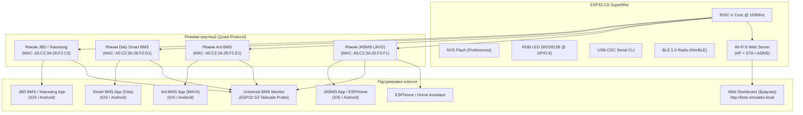

# 🔋 Можливості проєкту: Універсальний 4-в-1 BLE Емулятор BMS (JBD, Daly, Ant та JK) (ESP32-C6 / ESP32-S3)

<p align="center">
  <a href="PROJECT_CAPABILITIES.md"><b>English Spec</b></a> |
  <a href="PROJECT_CAPABILITIES_UA.md"><b>Українська версія</b></a> |
  <a href="README.md"><b>English README</b></a> |
  <a href="README_UA.md"><b>Українська README</b></a>
</p>

---

## 📌 1. Загальний огляд проєкту

**Universal Quad-BMS Emulator** — це повнофункціональний, автономний апаратно-програмний емулятор акумуляторних систем керування (BMS) на базі мікроконтролера **ESP32-C6** (з підтримкою **ESP32-S3**). 

Емулятор реалізує **універсальний 4-протокольний рушій** (Quad-Protocol Engine) і здатний на льоту повністю імітувати роботу 4 найпопулярніших у світі стандартів розумних BMS:
1. **JBD / Xiaoxiang / Jiabaida / Overkill Solar BMS** (`BS-26A-072-005`)
2. **Daly Smart BMS (DL-xxxx)** (`DL-401804015491`)
3. **Ant BMS (ANT-BMS серія)** (динамічні імена `ANT-BMS-08S`, `ANT-BMS-16S`)
4. **JKBMS (JiKong протокол JK02)** (динамічні імена `JK-B2A8S20P`, `JK-B2A16S20P`)

Проєкт розроблено для швидкого тестування, калібрування діагностичних шлюзів (ESP32 Universal Monitor / Tailscale Probe), інверторів (Growatt, Deye, Datouboss, Sandisolar, Victron), систем автоматизації Home Assistant / ESPHome та перевірки офіційних мобільних додатків без необхідності підключення до небезпечної високовольтної акумуляторної батареї.

---

## ⚡ 2. Архітектура та ключові особливості



---

## 🔄 3. Перемикання режимів на льоту (JBD ↔ Daly ↔ Ant ↔ JK)

Перемикання між 4 протоколами реалізовано декількома зручними способами:

1. **Кнопка BOOT (GPIO 9)**:
   - Тривале утримання (> 1.5 с) циклічно перемикає режими: **JBD → Daly → Ant → JK → JBD**.
   - Утримання кнопки при подачі живлення також перемикає режими.
2. **Апаратний Double Reset (подвійний клік кнопки RST)**:
   - Подвійне натискання кнопки **RST / RESET** на платі ESP32-C6 з інтервалом менше 2.5 секунди циклічно перемикає режим.
   - Поточний режим зберігається в енергонезалежній пам'яті **NVS (Non-Volatile Storage)** і автоматично відновлюється після вимкнення живлення.
3. **Інтерактивні Serial-команди (USB-CDC 115200 baud)**:
   - `j` або `jbd`: перейти в режим JBD BMS.
   - `y` або `daly`: перейти в режим Daly Smart BMS.
   - `a` або `ant`: перейти в режим Ant BMS.
   - `k` або `jk`: перейти в режим JKBMS (JK02).
   - `m` або `toggle`: циклічно перемкнути режим.
4. **Веб-панель керування та REST API**:
   - Клік на кнопку у Веб-інтерфейсі або POST-запит на `/api/set-proto` (`{"proto": "jk"}`).
   - `m` або `M` — перемкнути режим (Toggle JBD / DALY).
   - `j` або `J` — примусово увімкнути режим JBD BMS.
   - `y` або `Y` — примусово увімкнути режим Daly BMS.
3. **Автоматизований баш-скрипт (`switch_mode.sh`)**:
   - Відправляє команди в порт `/dev/cu.usbmodem*` з командного рядка: `./switch_mode.sh daly` або `./switch_mode.sh jbd`.

При зміні режиму мікроконтролер автоматично змінює:
- Профіль реклами BLE (Advertised Name, Service UUIDs, Manufacturer Data).
- Апаратну MAC-адресу BLE.
- Стек обробників протоколу GATT.
- Профіль ідентифікації Device Information Service (0x180A).

---

## 🔋 4. Фізичний рушій та конфігурації акумуляторів (4S, 8S, 16S ... 32S)

Емулятор оснащено динамічною масштабованою математичною моделлю акумуляторної батареї з підтримкою різних типів з'єднання та хімії:

### А. Підтримувані конфігурації послідовного з'єднання (Cell Count Configurations):
1. **4S (12V / 12.8V LiFePO4)**:
   - **Робочий діапазон напруг**: $10.0\text{ В} \dots 14.6\text{ В}$ (номінальна напруга $12.8\text{ В}$).
   - **Застосування**: Автомобільні бортові мережі, кемпери, човни, переносні зарядні станції, 12-вольтові ДБЖ.
   - **Готовий калібрувальний файл у репозиторії**: `4s standard LiFePO4 Alf-20210608.fig`.
   - **Програмна ідентифікація**: версія Daly `12_231116_001T`, JBD профіль `JBD-SP04S020` / `DP04S007`.

2. **8S (24V / 25.6V LiFePO4) — Базовий профіль за замовчуванням (Default)**:
   - **Робочий діапазон напруг**: $20.0\text{ В} \dots 29.2\text{ В}$ (номінал $25.6\text{ В}$, робоча точка під навантаженням $17\text{ А}$ $\sim 26.24\text{ В}$, активна потужність $\sim 445\text{ Вт}$).
   - **Застосування**: Домашні резервні системи живлення (UPS), 24V сонячні станції та телеком-обладнання.
   - **Готовий калібрувальний файл у репозиторії**: `8s standard LiFePO4 Alf-20210608.fig`.
   - **Програмна ідентифікація**: Daly `DL-8S-200A` (`24_231116_001T`), JBD `DB24SF01 V1.0` / `BS-26A-072-005` (8S 200A).

3. **16S (48V / 51.2V LiFePO4)**:
   - **Робочий діапазон напруг**: $40.0\text{ В} \dots 58.4\text{ В}$ (номінальна напруга $51.2\text{ В}$).
   - **Застосування**: Індустріальний стандарт для житлових та комерційних 48V гібридних сонячних інверторів (Deye, Growatt, Victron, Must, Axioma, Luxpower, Sermatec) та серверних акумуляторних модулів (Server Rack Batteries).
   - **Готовий калібрувальний файл у репозиторії**: `16s standard LiFePO4 Alf-20210608.fig`.

4. **Універсальне динамічне масштабування (Universal 3S–32S)**:
   - Емулятор підтримує довільну кількість комірок від **3S до 32S** без необхідності перепрошивки:
     - У протоколі **JBD**: регістр EEPROM `0x2F` (Cell Count) дозволяє задавати значення $3 \dots 32$ на льоту.
     - У протоколі **Daly Modbus**: регістри `0x0031` (статус кількості комірок) та `0x0083` (конфігураційний регістр кількості комірок) приймають значення $3 \dots 32$. Напруги комірок транслюються в діапазоні холдинг-регістрів `0x0000..0x001F` (1..32 комірки).
     - У протоколі **Daly UART**: команди `0x50` та `0xD6` налаштовують кількість комірок, а фрейми телеметрії `0x95` автоматично формують динамічну кількість 3-коміркових чанків.
   - Загальна напруга акумуляторного блоку розраховується сумуванням активних комірок:
     $$U_{pack} = \sum_{i=1}^{N} U_{cell\_i}$$

---

### Б. Підтримувані типи електрохімії акумуляторів:
- **LiFePO4 (LFP)**: номінальна напруга $3.2\text{ В}$ (робочий діапазон $2.5\text{ В} \dots 3.65\text{ В}$). Найпоширеніші збірки: 4S (12.8V), 8S (25.6V), 16S (51.2V).
- **Li-ion / NMC (Ternary)**: номінальна напруга $3.6\text{–}3.7\text{ В}$ (робочий діапазон $2.8\text{ В} \dots 4.2\text{ В}$). Поширені збірки: 3S (11.1V), 7S (25.9V), 10S (36V), 13S/14S (48V), 20S (72V).
- **LTO (Lithium Titanate)**: номінальна напруга $2.3\text{–}2.4\text{ В}$ (робочий діапазон $1.5\text{ В} \dots 2.8\text{ В}$). Поширені збірки: 5S/6S (12V), 10S/11S (24V), 20S/22S (48V).

---

### В. Динамічна поведінка фізичного рушія:
* **Живе «дихання» комірок (Dynamic Cell Breathing)**:
  - Напруга кожної окремої комірки безперервно коливається за індивідуальним синусоїдальним законом із фазовим зміщенням та псевдовипадковим мікро-шумом ($\pm 2\text{–}5\text{ мВ}$) навколо робочої точки ($3.28\text{ В}$ під розрядом, $3.45\text{ В}$ при заряді, $3.32\text{ В}$ у спокої).
  - Динамічно розраховується дельта розбалансу комірок ($3\text{–}12\text{ мВ}$) та визначаються індекси комірок з мінімальною і максимальною напругою.
* **Режими навантаження та струмові криві**:
  - **Розряд (Discharge Mode)**: струм $-17.00\text{ А}$ (з реалістичним jitter $\pm 0.3\text{ А}$). Для базової збірки 8S це відповідає потужності розряду $\sim 445\text{ Вт}$.
  - **Заряд (Charge Mode)**: номінальний струм $+25.00\text{ А}$ з пульсаціями зарядного пристрою.
  - **Очікування (Standby Mode)**: струм $0.00\text{ А}$, потужність $0\text{ Вт}$.
* **Підрахунок ампер-годин (Coulomb Counting)**:
  - Безперервний інтеграл струму в часі ($I \times \Delta t$) перераховує залишкову ємність у режимі реального часу, з динамічним оновленням SOC (%).
* **Теплова модель (NTC Sensors)**:
  - NTC 1 (Датчик батареї 1): $\sim 26.0^\circ\text{C}$.
  - NTC 2 (Датчик батареї 2): $\sim 25.0^\circ\text{C}$.
  - NTC 3 / MOS Temp (Температура силових ключів): нагрівається під навантаженням до $28.0\dots 30.0^\circ\text{C}$.
* **Керування силовими ключами (FET Switches)**:
  - Підтримка незалежного розмикання/замикання **Charge MOS** та **Discharge MOS**.
  - При вимкненні Discharge FET струм миттєво падає до $0.00\text{ А}$, потужність стає $0\text{ Вт}$, а світлодіод переходить у режим очікування.

---

## 📱 5. Можливості режиму JBD / Xiaoxiang BMS

| Параметр | Значення / Реалізація |
| :--- | :--- |
| **Ім'я BLE** | `BS-26A-072-005` |
| **MAC-адреса BLE** | `A5:C2:3A:26:F2:C2` |
| **Основний сервіс** | Service `0xFF00` (Write: `0xFF02`, Notify: `0xFF01`) |
| **Дзеркальний сервіс** | Service `0xFFF0` (Write: `0xFFF2`, Notify: `0xFFF1`) |
| **MTU Chunking** | Автоматична нарізка пакетів по $\le 20$ байт із затримкою $25\text{ мс}$ (ідеальна сумісність з Android MTU=23 та iOS MTU=512) |
| **iOS CoreBluetooth Fix**| Вкладання MAC-адреси в `Manufacturer Data` Scan Response для миттєвого пошуку в iOS додатку |
| **Авторизація / PIN** | Команда `FF AA 15` та регістр `0x06` (підтримка PIN `123456`) |
| **Службові протоколи** | Sinowealth `3B 3C`, AT-команда `AT^VERSION?` $\rightarrow$ `DB24SF01 V1.0` |
| **EEPROM регістри** | Повна карта регістрів `0x10`..`0x3F`, `0xAA` (ємність, цикли, пороги захисту) |
| **AFE RAM (`0xFA`)** | Читання прямої пам'яті AFE (зсув `0x58`: напруги комірок) для Android |
| **Запис конфігурації** | Калібрування номінальної (`0x10`) та циклічної (`0x11`) ємності, струму (`0xE0`), кількості комірок (`0x2F`) |

---

## 🛡️ 6. Можливості режиму Daly Smart BMS

Режим Daly реалізує **гібридний подвійний протокол**:

### А. Протокол Modbus RTU over BLE (`0xD2`)
Призначений для оригінального мобільного додатку **Smart BMS** (iOS / Android):

* **Функція 0x03 (Read Holding Registers)**:
  * **Регістри `0x0000..0x001F`**: Напруги комірок 1..32 (мВ).
  * **Регістри `0x0020..0x0027`**: Температури NTC 1..8 (зі зміщенням $+40^\circ\text{C}$).
  * **Регістри `0x0028..0x0046`**: Повна телеметрія пакета (загальна напруга $0.1\text{ В}$, струм зі зміщенням $30000$, SOC, екстремуми напруг і температур, дельта, циклічність, статус ключів, потужність у Вт).
  * **Регістри `0x0047..0x0056`**: Дзеркальний блок окремих комірок (Single Cell Voltages 1..16).
  * **Регістри `0x0080..0x00A8`**: Блок системних налаштувань (номінальна ємність, пороги захисту за напругою, струмом і температурою).
  * **Регістри `0x00A9..0x00CB` (Ідентифікація, 35 регістрів = 70 байт)**:
    * Версія ПЗ: `24_231116_001T` (для 8S 24V) / `12_231116_001T`
    * Версія «заліза»: `DL-8S-200A`
    * Серійний номер (SN): `207JD160400278`
    * Пароль за замовчуванням: `123456`
  * **Регістри `0x00CC..0x00CD`**: Дата виробництва (`20240516`).
  * **Регістри `0x00CE..0x00D0`**: PID пристрою (`NoPID`).
* **Функція 0x06 (Write Single Register)**:
  * Керування Charge MOS: `0x00A5` / `0x00DA`
  * Керування Discharge MOS: `0x00A6` / `0x00D9`
  * Керування балансиром: `0x00A7` / `0x00CF`
  * Зміна номінальної ємності: `0x0080`
  * Зміна кількості комірок: `0x0083`

### Б. Фреймовий протокол UART-over-BLE (`0xA5`)
Призначений для **Universal BMS Diagnostic Monitor (ESP32-S3 Probe / Tailscale)**, драйверів ESPHome, Node-RED та інверторів:

* 13-байтні фрейми фіксованої довжини з контрольною сумою `sum & 0xFF`:
  * `0x90` — Загальна напруга, струм (offset 30000), SOC.
  * `0x91` — Екстремуми напруг: Max Cell mV, Min Cell mV, номери комірок.
  * `0x92` — Екстремуми температур: Max/Min Temp (offset 40).
  * `0x93` — Статус Charge/Discharge MOS, BMS Life, залишкова ємність (А·год).
  * `0x94` — Кількість комірок ($8$), кількість NTC ($3$), лічильник циклів.
  * `0x95` — Покомірковий моніторинг: динамічні послідовні фрейми (по 3 комірки у фреймі) з міжкадровим інтервалом $30\text{–}40\text{ мс}$ (без затирання BLE буфера).
  * `0x96` — Індивідуальні покази датчиків NTC1..NTC3.
  * `0x97` — Бітова маска активного балансування.
  * `0x98` — Повна 8-байтна бітова маска помилок та аварій (DI status).
  * `0xD9` / `0xDA` — Команди перемикання ключів розряду/заряду.

---

## 🐜 7. Специфікація емуляції Ant BMS

* **Емульовані моделі та профілі**:
  * **`ANT-BMS-08S`**: 8 послідовних комірок LiFePO4 ($24\text{В}$ номінал, $26.2\text{В}$ пачка, 8 комірок @ $\approx 3.28\text{В}$, $200\text{А·год}$).
  * **`ANT-BMS-16S`**: 16 послідовних комірок LiFePO4 ($48\text{В}$ номінал, $52.5\text{В}$ пачка, 16 комірок @ $\approx 3.28\text{В}$, $200\text{А·год}$).
  * **`ANT-BMS-24S`**: 24 послідовні комірки LiFePO4 ($72\text{В}$ номінал, $78.7\text{В}$ пачка, 24 комірки @ $\approx 3.28\text{В}$, $200\text{А·год}$).
  * **Динамічне найменування**: Автоматичне форматування `ANT-BMS-%02uS` відповідно до обраної кількості комірок ($3\text{S}\dots 32\text{S}$).
* **Базова MAC-адреса**: `A5:C2:3A:26:F2:E1` (виділена окрема MAC-адреса для уникнення конфліктів кешування GATT в iOS/Android).
* **GATT-профіль**:
  * Основний сервіс `0xFFE0` (Read/Write/Notify `0xFFE1`, Write `0xFFE2`).
  * Вторинний сервіс `0xFFF0` (Notify `0xFFF1`).
  * Nordic UART Service `6E400001-B5A3-F393-E0A9-E50E24DCCA9E` (RX `6E400002`, TX `6E400003`).
  * Сервіс ідентифікації `0x180A` (Model `0x2A24`, Manufacturer `0x2A29`, Firmware `0x2A26`, Hardware `0x2A27`).
* **Дводвигуновий протокольний стек (Modern Ant v2 + Legacy 140B)**:
  * **Сучасний динамічний протокол Ant BMS v2 (`7E A1`)** (Офіційний додаток Ant BMS та AntBMS v2):
    * **Команда запиту статусу**: Мобільний додаток надсилає `7E A1 01 00 00 F5 58 62 AA 55` (`ANT_COMMAND_STATUS = 0x01`).
    * **Кадр відповіді статусу (`0x11`)**: Змінна довжина `6 + payload_len + 4` байтів із 16-бітною контрольною сумою Modbus CRC:
      * Байти `0..1`: Заголовок `0x7E 0xA1`.
      * Байт `2`: Функція `0x11` (`ANT_FRAME_TYPE_STATUS`).
      * Байти `3..4`: Адреса `0x0000`.
      * Байт `5`: Довжина корисного навантаження ($112 + \text{cells} \times 2 + \text{temp\_sensors} \times 2$).
      * Байт `6`: Рівень доступу (`0x05`).
      * Байт `7`: Стан батареї ($1=\text{Спокій}, 2=\text{Заряд}, 3=\text{Розряд}$).
      * Байт `8`: Кількість датчиків температури ($4$).
      * Байт `9`: Кількість активних комірок (наприклад, $8$ або $16$).
      * Байти `10..33`: 8-байтні бітові маски захистів, попереджень та балансування.
      * Байти `34..(34 + \text{cells} \times 2)`: Напруги окремих комірок у мВ (uint16 Little-Endian).
      * Байти `34 + \text{cells}\times 2 \dots`: Температури NTC1..NTC4 в $1^\circ\text{C}$ (int16 Little-Endian).
      * Наступні поля: Температура MOSFET, температура балансира, загальна напруга в $0.01\text{В}$, струм у $0.1\text{А}$, рівень заряду SOC ($0\dots 100\%$), стан здоров'я SOH ($100\%$), стан ключів MOS, статус балансира ($0\times 04 = \text{ON}$), ємність у $\mu\text{Ah}$, потужність у Ватах, час роботи, екстремуми напруг та індекси комірок.
      * Контрольна сума: **CRC-16/Modbus** (поліном `0xA001`, init `0xFFFF`), розраховується за `frame[1 .. len-5]`.
      * Завершення кадру: `0xAA 0x55`.
    * **Запит інформації про пристрій (`0x02` / `0x04` / `0x026C`)**: Повертає кадр `0x12` з назвою моделі (`ANT-BMS-08S`) та версією прошивки (`ANT_V2_10.07`).
    * **Запит регістрів / Settings ACK (`0x61`)**: Відповідає на запити конфігураційних регістрів структурованими відповідями ACK.
  * **Класичний протокол (140-байтний кадр)** (Для старіших діагностичних комплексів):
    * Преамбула: `0xAA 0x55 0xAA 0xFF`.
    * Послідовна передача 32 комірок (uint16 Big-Endian у мВ), струму (0.1A), SOC, ємності, температур та сумарної контрольної суми 16-біт Big-Endian за байтами 4..137.
    * Ініціюється опитуванням `0xDB 0xDB` або `0x5A 0x5A`.
* **Автоматичне визначення типу клієнта**:
  * Емулятор аналізує перші байти від клієнта: якщо надходить `7E A1`, періодична трансляція автоматично перемикається на Ant v2, якщо старий запит — на 140-байтний потік.

---

## ⚡ 8. Специфікація емуляції JKBMS (JiKong JK02)

* **Емульовані моделі та профілі**:
  * **`JK-B2A8S20P`**: 8 комірок LiFePO4 ($24\text{В}$, активний балансир 2A, номінальний струм 200A).
  * **`JK-B2A16S20P`**: 16 комірок LiFePO4 ($48\text{В}$, активний балансир 2A, номінальний струм 200A).
  * **`JK-B2A24S20P`**: 24 комірки LiFePO4 ($72\text{В}$, активний балансир 2A, номінальний струм 200A).
  * **Динамічне найменування**: Автоматичне форматування `JK-B2A%uS20P` відповідно до кількості комірок ($3\text{S}\dots 32\text{S}$).
* **Базова MAC-адреса**: `A5:C2:3A:26:F2:F1` (виділена окрема MAC-адреса).
* **GATT-профіль**:
  * Основний сервіс `0xFFE0` (Read/Write/Notify `0xFFE1`, Write `0xFFE2`).
  * Сервіс ідентифікації `0x180A` (Model `0x2A24`, Manufacturer `0x2A29`, Firmware `0x2A26`, Hardware `0x2A27`).
* **Фіксований розмір та багатопоточність (Thread Safety)**:
  * Усі комунікаційні кадри JK02 мають довжину **300 байт** із контрольною сумою в байті 299 (`crc = sum(bytes 0..298) & 0xFF`).
  * Передача захищена мьютексом FreeRTOS `s_bleTxMutex` порціями по 20 байт (MTU=23 pacing), що повністю унеможливлює пошкодження або розрив пакетів під час одночасних запитів додатку.
* **Типи кадрів та розташування байтів**:
  * **Кадр інформації про пристрій Device Information (300 Байт, Тип `0x03`)** — надсилається у відповідь на `0x97`:
    * Преамбула: `0x55 0xAA 0xEB 0x90 0x03` + лічильник.
    * Байти `6..21`: Рядок моделі (наприклад, `JK-B2A8S20P`).
    * Байти `22..29`: Версія заліза (`10.XG`).
    * Байти `30..37`: Версія ПЗ (`10.07`).
    * Байти `38..41`: Загальний час роботи в секундах (uint32 Little-Endian).
    * Байти `42..45`: Лічильник увімкнень ($1$).
    * Байти `46..61`: Ім'я пристрою (`JK-B2A8S20P`).
    * Байти `62..77`: Пароль пристрою (`1234`).
    * Байти `78..83`: Дата виготовлення (`220511`).
    * Байти `86..96`: Серійний номер (`2041803028`).
    * Байти `97..101`: Пароль авторизації (`1234`).
    * Байти `102..117`: Дані користувача (`Input Userdata`).
    * Байти `118..133`: Сервісний пароль налаштувань (`123456`).
  * **Кадр телеметрії комірок Cell Info (300 Байт, Тип `0x02`)** — надсилається у відповідь на `0x96` та щосекундно:
    * Преамбула: `0x55 0xAA 0xEB 0x90 0x02` + лічильник.
    * Байти `6..53`: 24 комірки (uint16 Little-Endian у мВ).
    * **Байти `54..57` — Бітова маска активних комірок (`cellMask`)**: `(1UL << cell_count) - 1` (наприклад, `0x000000FF` для 8S). Саме вона вмикає відображення напруг комірок в офіційному додатку JKBMS (без неї додаток малює прочерки `--`).
    * Байти `58..59`: Середня напруга комірок у мВ (uint16 Little-Endian).
    * Байти `60..61`: Дельта розбалансу комірок у мВ (uint16 Little-Endian).
    * Байт `62`: 0-індекс комірки з максимальною напругою ($0\dots 23$).
    * Байт `63`: 0-індекс комірки з мінімальною напругою ($0\dots 23$).
    * **Байти `64..111` — Опори балансувальних дротів**: 24 опори дротів (uint16 Little-Endian у $\text{m}\Omega$, $100\,\text{m}\Omega = 0.100\,\Omega$).
    * Байти `114..117`: Бітова маска попереджень опору дротів ($0$).
    * **Байти `118..121` — Загальна напруга батареї**: Повна напруга в мВ (uint32 Little-Endian, $\approx 26\,237\text{ мВ}$).
    * **Байти `122..125` — Миттєва потужність**: Потужність у мВт (uint32 Little-Endian, $\approx 440\,000\text{ мВт}$).
    * **Байти `126..129` — Струм батареї**: Знаковий струм у мА (int32 Little-Endian, $+=\text{Заряд}, -=\text{Розряд}$).
    * **Байти `130..135` — Датчики температури**: NTC1, NTC2 та MOS у $0.1^\circ\text{C}$ (int16 Little-Endian).
    * Байти `136..137`: Бітова маска помилок ($0$).
    * Байти `138..139`: Струм балансування в мА (int16 Little-Endian).
    * Байт `140`: Дія балансира ($0=\text{Вимк}, 1=\text{Заряд}, 2=\text{Розряд}$).
    * **Байт `141` — Рівень заряду (SOC %)**: Ціле число ($0\dots 100\%$, uint8).
    * Байти `142..145`: Залишкова ємність у мА·год (uint32 Little-Endian, $193\,640\text{ мА·год}$).
    * Байти `146..149`: Номінальна ємність у мА·год (uint32 Little-Endian, $200\,000\text{ мА·год}$).
    * Байти `150..153`: Кількість циклів батареї (uint32 Little-Endian, $1$).
    * Байти `154..157`: Циклічна ємність у мА·год (uint32 Little-Endian).
    * Байт `158`: Стан здоров'я (SOH $100\%$).
    * Байти `162..165`: Загальний час роботи в секундах (uint32 Little-Endian).
    * Байти `166..169`: Стани перемикачів (Charge MOS, Discharge MOS, Precharge, Балансир).
    * Байти `202..203`: Напруга акумуляторного блоку в $0.01\text{ В}$ (uint16 Little-Endian, $2623 = 26.23\text{ В}$).
  * **Кадр налаштувань Settings (300 Байт, Тип `0x01`)** — надсилається у відповідь на `0x01`:
    * Преамбула: `0x55 0xAA 0xEB 0x90 0x01` + лічильник.
    * Повні пороги спрацювання: Smart sleep, Cell UVP ($2800\text{ мВ}$), Cell UVPR ($3000\text{ мВ}$), Cell OVP ($3650\text{ мВ}$), Cell OVPR ($3550\text{ мВ}$), максимальні струми заряду/розряду, поріг запуску балансира, кількість комірок ($8$ або $16$), стани MOSFET, номінальна ємність.
* **Команди та запити**:
  * Запит Device Info: `AA 55 90 EB 97 00 ...`
  * Запит Cell Info: `AA 55 90 EB 96 00 ...`
  * Запит Settings: `AA 55 90 EB 01 00 ...`
  * Запис регістрів ключів: `0x1D` (Charge MOS), `0x1E` (Discharge MOS), `0x1F` (Балансир).
  * Автоматичний burst із трьох кадрів при підключенні/підписці (`Device Info` $\to$ `Settings` $\to$ `Cell Info`).

---

## 🎛️ 9. Профілі конфігурацій моделей та інструкція перемикання (ANT, JK, JBD, Daly)

Емулятор динамічно адаптує структуру протокольних кадрів, імена BLE та параметри математичної моделі батареї відповідно до обраного протоколу та конфігурації комірок:

### А. Матриця емульованих моделей

| Режим BMS | Конфігурація 8S (24В блок) | Конфігурація 16S (48В блок) | Конфігурація 24S (72В блок) | Довільна збірка (3S..32S) |
| :--- | :--- | :--- | :--- | :--- |
| **Ant BMS** | `ANT-BMS-08S` ($26.2\text{В}$, 8 комірок) | `ANT-BMS-16S` ($52.5\text{В}$, 16 комірок) | `ANT-BMS-24S` ($78.7\text{В}$, 24 комірки) | `ANT-BMS-%02uS` |
| **JKBMS** | `JK-B2A8S20P` ($26.2\text{В}$, 2A бал, 200A) | `JK-B2A16S20P` ($52.5\text{В}$, 2A бал, 200A) | `JK-B2A24S20P` ($78.7\text{В}$, 2A бал, 200A) | `JK-B2A%uS20P` |
| **JBD BMS** | `BS-26A-072-005` (8S LiFePO4 профіль) | `BS-26A-072-005` (16S LiFePO4 профіль) | `BS-26A-072-005` (24S LiFePO4 профіль) | Динамічна кількість |
| **Daly BMS** | `DL-401804015491` (8S Modbus профіль) | `DL-401804015491` (16S Modbus профіль) | `DL-401804015491` (24S Modbus профіль) | Динамічна кількість |

### Б. Як перемикатися між протоколами та моделями

#### Спосіб 1: Команди Serial CLI (Миттєве перемикання через USB-термінал)
Підключіться до порту `/dev/cu.usbmodem*` зі швидкістю **115200 baud**:
* **Перемикання протоколу**:
  * Введіть `a` або `ant` $\to$ Перемикання в режим **Ant BMS** (`ANT-BMS-08S`, MAC `A5:C2:3A:26:F2:E1`).
  * Введіть `k` або `jk` $\to$ Перемикання в режим **JKBMS** (`JK-B2A8S20P`, MAC `A5:C2:3A:26:F2:F1`).
  * Введіть `j` або `jbd` $\to$ Перемикання в режим **JBD BMS** (`BS-26A-072-005`, MAC `A5:C2:3A:26:F2:C2`).
  * Введіть `y` або `daly` $\to$ Перемикання в режим **Daly Smart BMS** (`DL-401804015491`, MAC `A5:C2:3A:26:F2:D1`).
* **Зміна моделі та кількості комірок**:
  * Введіть `8s` або `cells 8` $\to$ Встановлює конфігурацію $8\text{S}$ (наприклад, `ANT-BMS-08S` / `JK-B2A8S20P`).
  * Введіть `16s` або `cells 16` $\to$ Встановлює конфігурацію $16\text{S}$ (наприклад, `ANT-BMS-16S` / `JK-B2A16S20P`).
  * Введіть `24s` або `cells 24` $\to$ Встановлює конфігурацію $24\text{S}$ (наприклад, `ANT-BMS-24S` / `JK-B2A24S20P`).
  * *Усі налаштування автоматично зберігаються в енергонезалежній пам'яті NVS Flash.*

```text
=== Приклад перемикання через Serial CLI ===
> a
[SYSTEM] Mode set to ANT BMS (MAC: A5:C2:3A:26:F2:E1) -> Restarting...
> 16s
[SYSTEM] Cell count set to 16S! Pack voltage updated to 52.48V.
[BLE] Advertising started successfully as 'ANT-BMS-16S'.
> k
[SYSTEM] Mode set to JK BMS (MAC: A5:C2:3A:26:F2:F1) -> Restarting...
[BLE] Advertising started successfully as 'JK-B2A16S20P'.
```

#### Спосіб 2: Апаратна кнопка керування (Кнопка BOOT @ GPIO 9)
* **Тривале утримання під час роботи (> 1.5 с)**:
  * Затисніть кнопку **BOOT** на платі ESP32.
  * Адресний світлодіод WS2812B блиматиме бурштиновим кольором, а після досягнення порога 1.5 с засвітиться **яскраво-зеленим**.
  * Відпустіть кнопку: емулятор циклічно перемкне протокол (**JBD** $\to$ **Daly** $\to$ **Ant** $\to$ **JK** $\to$ **JBD**) та перезавантажиться з відповідною новою MAC-адресою.
* **Утримання при підключенні живлення (Power-on Reset)**:
  * Затисніть кнопку BOOT і вставте плату в USB, тримайте до білого світлодіода, потім відпустіть для зміни протоколу перед стартом.
* **Швидке подвійне натискання RST (Double-Reset)**:
  * Подвійне натискання кнопки Reset протягом 2.5 секунд перемикає активний режим.

#### Спосіб 3: Вбудований веб-інтерфейс (Wi-Fi AP та Station)
* Підключіться зі смартфона або ПК до мережі **`BMS-Emulator-Setup`** (IP: `192.168.4.1`) або відкрийте **`http://bms-emulator.local`**.
* У розділі **BMS Protocol Settings** оберіть **Ant BMS**, **JK BMS**, **JBD BMS** або **Daly BMS** зі спадного списку.
* Натисніть кнопку потрібного пресету (**4S**, **8S**, **16S**) або вкажіть довільну кількість комірок ($3\dots 32$).

---

## 🎨 10. Апаратна індикація (WS2812B RGB LED @ GPIO 8)

ESP32-C6 SuperMini оснащено адресним світлодіодом WS2812B, який відображає поточний стан системи в реальному часі:

| Колір світлодіода | Стан емулятора |
| :--- | :--- |
| 🔴 **Червоний** | Режим очікування клієнта JBD BMS (BLE Advertising) |
| 🟣 **Пурпурний/Маджента** | Режим очікування клієнта Daly Smart BMS (BLE Advertising) |
| 🔵 **Синій** | Режим очікування клієнта Ant BMS (BLE Advertising) |
| 🟠 **Помаранчевий** | Режим очікування клієнта JKBMS (BLE Advertising) |
| 🟢 **Зелений** | Спокій / Standby ($0\text{ А}$, ключі замкнено) |
| 🩵 **Блакитний (Cyan)** | Активний заряд батареї (Charge, $+25\text{ А}$) |
| 🔵 / 🟠 | Активний розряд батареї під навантаженням (Discharge, $-17\text{ А}$) |
| ⚪ **Білий** | Повний заряд акумулятора ($100\%\text{ SOC}$) |
| 🟡 **Жовтий** | Спрацювання захисту або симуляція аварії |

---

## 💻 11. Команди Serial CLI (USB 115200 baud)

Під час підключення до плати через будь-який монітор порту доступне інтерактивне керування:

* `m` або `toggle` — Циклічно перемкнути протокол (**JBD** → **Daly** → **Ant** → **JK**).
* `j` або `jbd` — Примусово встановити режим **JBD BMS**.
* `y` або `daly` — Примусово встановити режим **Daly Smart BMS**.
* `a` або `ant` — Примусово встановити режим **Ant BMS**.
* `k` або `jk` — Примусово встановити режим **JKBMS**.
* `mac` — Меню керування MAC-адресою BLE адаптера.
* `mac <1-N>` — Вибрати збережений профіль MAC (наприклад, `mac 2`).
* `mac set <addr>` — Встановити та застосувати активну MAC-адресу.
* `4s` / `8s` / `16s` / `24s` — Встановити кількість комірок (або `cells <N>`, 3..32).
* `w` або `wifi` — Показати статус Wi-Fi, IP, SSID та рівень сигналу RSSI.
* `wifi <SSID> <PASS>` — Підключитись до домашньої мережі Wi-Fi.
* `1` або `dis` — Увімкнути режим **Розряду** (Discharge, $-17.00\text{ А}$).
* `2` або `c` — Увімкнути режим **Заряду** (Charge, $+25.00\text{ А}$).
* `0` або `idle` — Увімкнути режим **Спокою** (Standby, $0.00\text{ А}$).
* `f` або `fet` — Перемкнути ключі **Charge/Discharge FET**.
* `+` / `-` — Збільшити / зменшити рівень заряду SOC на $\pm 1\%$.
* `t` або `telemetry` — Надіслати примусовий залп повної телеметрії в активний канал BLE.
* `?` або `help` — Вивести довідку по доступних командах.

---

## 🌐 12. Вбудована Веб-панель керування та мережеві можливості (Modes A & B)

Емулятор оснащено повноцінним вбудованим асинхронним веб-сервером із сучасним Dark Glassmorphic інтерфейсом (у стилі проєктів SandiSolar та Universal BMS Monitor), який працює паралельно з BLE-емуляцією без просідання продуктивності:

### А. Режими мережевого підключення
* **Варіант А (Автономна точка доступу AP / Captive Portal)**:
  * Емулятор створює власну Wi-Fi мережу з SSID **`BMS-Emulator-Setup`** (IP-адреса: `192.168.4.1`, відкрита, без пароля).
  * **DNS Captive Portal**: порт 53 перехоплює всі запити й автоматично відкриває веб-інтерфейс при підключенні зі смартфона або комп'ютера (підтримка Android, iOS / macOS Captive Assistant, Windows NCSI).
* **Варіант Б (Локальна Wi-Fi мережа / Station Mode)**:
  * Підключення до домашньої або лабораторної мережі Wi-Fi (2.4 ГГц) через сторінку `/setup`.
  * **mDNS Responder**: доступ до веб-панелі за зручним доменом **`http://bms-emulator.local`** (або через IP, виданий DHCP).
  * **Fail-Safe Fallback**: у разі недоступності роутера або збою аутентифікації емулятор автоматично активує режим точки доступу AP.

### Б. Можливості веб-інтерфейсу (Dark Glassmorphic UI)
* **Двомовність (UA / EN)**: миттєве перемикання мови інтерфейсу в 1 клік зі збереженням вибору в `localStorage`.
* **Жива телеметрія (Live KPI)**:
  * Загальна напруга пакета ($V$), струм розряду/заряду ($A$), вихідна потужність ($W$), рівень SOC ($0\dots 100\%$), залишкова ємність ($Ah$), температури датчиків NTC ($^\circ C$) та дельта розбалансу $\Delta V$ ($mV$).
* **Матриця напруг комірок (Cell Voltage Matrix)**:
  * Динамічне відображення напруг кожної підключеної комірки ($mV$) із кольоровими смужками стану та автоматичним виділенням мінімальної (**MIN**, синій) та максимальної (**MAX**, зелений) комірки.
* **Швидке перемикання конфігурацій (Cell Count Presets)**:
  * Кнопки швидкого вибору **4S (12V)**, **8S (24V)**, **16S (48V)** або введення будь-якого довільного значення від **3S до 32S** на льоту. Налаштування одразу зберігаються в NVS Flash.
* **Керування симуляцією та навантаженням**:
  * Перемикання режимів: **Розряд** ($-17\text{ А}$), **Заряд** ($+25\text{ А}$), **Спокій** ($0\text{ А}$).
  * Повзунок рівня заряду SOC ($0\dots 100\%$) з автоматичним перерахунком напруг комірок та залишкової ємності.
  * Незалежні тумблери керування ключами **Charge MOSFET** та **Discharge MOSFET**.
  * Перемикач протоколу в один клік: **JBD BMS** $\leftrightarrow$ **Daly Smart BMS** $\leftrightarrow$ **Ant BMS** $\leftrightarrow$ **JK BMS**.
* **Оновлення прошивки по повітрю (Web OTA)**:
  * Можливість прошити новий файл `firmware.bin` прямо через веб-інтерфейс без використання USB-кабелю.

### В. REST API ендпоінти
| Метод | Ендпоінт | Опис та параметри |
| :--- | :--- | :--- |
| `GET` | `/api/data` | Повний JSON-зріз поточної телеметрії, конфігурації комірок та ключів FET |
| `POST` | `/api/set-cells` | Зміна кількості комірок: `cells=4`, `cells=8`, `cells=16` (або `3..32`) |
| `POST` | `/api/set-proto` | Зміна протоколу BMS: `proto=jbd`, `proto=daly`, `proto=ant`, `proto=jk` |
| `POST` | `/api/restart` | Програмне перезавантаження плати ESP32 |
| `POST` | `/update` | Завантаження нового бінарного файлу прошивки (OTA Update) |

---

## 📱 13. Перевірена сумісність з клієнтами

| Клієнт / Додаток | Стандарт протоколу | Ім'я пристрою в ефірі | Перевірений функціонал | Статус верифікації |
| :--- | :--- | :--- | :--- | :---: |
| **JBD BMS App** (iOS / Android) | `PROTO_JBD` | `BS-26A-072-005` | Телеметрія в реальному часі, напруги комірок, запис/читання EEPROM, PIN-авторизація (`123456`) | ✅ 100% Перевірено |
| **Xiaoxiang BMS App** (iOS / Android) | `PROTO_JBD` | `BS-26A-072-005` | Напруга пакета, струм, SOC, ємність, графіки комірок, аварійні сповіщення, керування FET | ✅ 100% Перевірено |
| **Smart BMS App** (Daly, iOS / Android) | `PROTO_DALY` | `DL-401804015491` | Телеметрія Modbus D2, 8/16 комірок, температури, серійний номер, версія прошивки, ключі FET | ✅ 100% Перевірено |
| **Ant BMS App / MAYA / AntBMS v2** (iOS / Android) | `PROTO_ANT` | `ANT-BMS-08S` / `16S` | Сучасний протокол `7E A1`, матриця 8/16 комірок, кругова шкала SOC, температури (MOS, балансир, T1..T4), ємність, ключі FET | ✅ 100% Перевірено |
| **JKBMS App (JiKong App)** (iOS / Android) | `PROTO_JK` | `JK-B2A8S20P` / `16S` | Повні 300-байтні кадри JK02, напруги 8/16 комірок, опір дротів ($0.100\,\Omega$), активне балансування, розблокування паролем налаштувань (`123456` / `1234`) | ✅ 100% Перевірено |
| **Universal BMS Monitor** (ESP32-S3 Probe) | Всі 4 протоколи | Динамічне автовизначення | Автоматичне розпізнавання протоколів, високочастотний BLE-опитування, онлайн-вебпанель через Tailscale | ✅ 100% Перевірено |
| **ESPHome BMS Components** | Всі 4 протоколи | Стандартні UUID | Нативна сумісність із компонентами `jbd_bms`, `daly_bms`, `ant_bms` та `jk_bms_ble` | ✅ 100% Перевірено |
  * Повзунок ручного регулювання SOC ($0\dots 100\%$) з миттєвим перерахунком напруг та залишкової ємності.
  * Незалежні тумблери керування ключами **Charge MOSFET** та **Discharge MOSFET**.
  * Перемикач симуляції протоколу: **JBD BMS** $\leftrightarrow$ **Daly Smart BMS**.
* **Оновлення прошивки по повітрю (Web OTA)**:
  * Можливість прошити новий файл `firmware.bin` прямо через веб-інтерфейс без використання USB-кабелю.

### В. REST API ендпоінти
| Метод | Ендпоінт | Опис та параметри |
| :--- | :--- | :--- |
| `GET` | `/api/data` | Повний JSON-зріз поточної телеметрії, конфігурації комірок та ключів FET |
| `POST` | `/api/set-cells` | Зміна кількості комірок: `cells=4`, `cells=8`, `cells=16` (або `3..32`) |
| `POST` | `/api/set-proto` | Зміна протоколу BMS: `proto=jbd` або `proto=daly` |
| `POST` | `/api/set-mode` | Зміна робочого режиму батареї: `mode=discharge`, `mode=charge`, `mode=standby` |
| `POST` | `/api/set-soc` | Зміна рівня SOC у відсотках: `soc=0..100` |
| `POST` | `/api/set-fet` | Керування транзисторами: `fet=charge\|discharge`, `state=0\|1` |
| `GET` | `/api/scan-wifi` | Сканування навколишніх Wi-Fi мереж із поверненням списку SSID та RSSI |
| `POST` | `/api/save-wifi` | Збереження облікових даних Wi-Fi: `ssid=...`, `pass=...` та підключення |
| `POST` | `/api/reset-wifi`| Скидання налаштувань Wi-Fi та повернення в автономний режим AP |
| `POST` | `/api/restart` | Програмне перезавантаження плати ESP32 |
| `POST` | `/update` | Завантаження нового бінарного файлу прошивки (OTA Update) |

---

## 📁 11. Структура файлів прошивки та бінарні релізи

* **Вихідний код**: [`src/main.cpp`](file:///Users/ihormchakraborty/mqtt/JBD-bms-emulator/src/main.cpp)
* **Скрипт перемикання режиму**: [`switch_mode.sh`](file:///Users/ihormchakraborty/mqtt/JBD-bms-emulator/switch_mode.sh)
* **Скомпільовані образи**:
  * `bin/jbd_emulator_esp32_c6_factory.bin` — Повний образ прошивки для ESP32-C6 (прошивається за адресою `0x0000`).
  * `bin/jbd_emulator_esp32_c6_firmware.bin` — Образ додатку OTA для ESP32-C6 (`0x10000`).
  * `bin/jbd_emulator_esp32_s3_factory.bin` — Повний образ прошивки для ESP32-S3 (`0x0000`).
  * `bin/jbd_emulator_esp32_s3_firmware.bin` — Образ додатку OTA для ESP32-S3 (`0x10000`).

### Команда швидкої прошивки готового бінарника:
```bash
esptool.py -p /dev/cu.usbmodem* -b 921600 write_flash 0x0000 bin/jbd_emulator_esp32_c6_factory.bin
```
