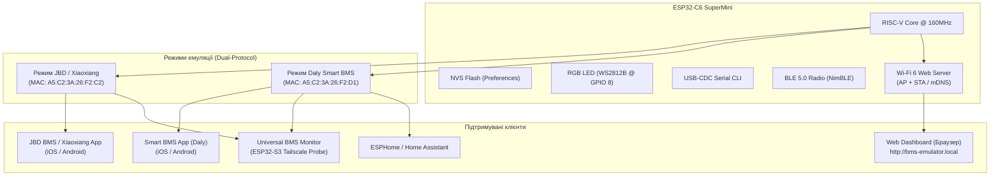

# 🔋 Можливості проєкту: JBD & Daly BMS BLE Emulator (ESP32-C6 / ESP32-S3)

<p align="center">
  <a href="PROJECT_CAPABILITIES.md"><b>English Spec</b></a> |
  <a href="PROJECT_CAPABILITIES_UA.md"><b>Українська версія</b></a> |
  <a href="README.md"><b>English README</b></a> |
  <a href="README_UA.md"><b>Українська README</b></a>
</p>

---

## 📌 1. Загальний огляд проєкту

**JBD & Daly BMS Emulator** — це повнофункціональний, автономний апаратно-програмний емулятор акумуляторних систем керування (BMS) на базі мікроконтролера **ESP32-C6** (з підтримкою **ESP32-S3**). 

Емулятор реалізує **подвійний протокольний стек** (Dual-Protocol Engine) і здатний на льоту повністю імітувати роботу двох найпопулярніших у світі стандартів розумних BMS:
1. **JBD / Xiaoxiang / Jiabaida / Overkill Solar BMS**
2. **Daly Smart BMS (DL-xxxx)**

Проєкт розроблено для швидкого тестування, калібрування діагностичних шлюзів (ESP32 Universal Monitor / Tailscale Probe), інверторів (Growatt, Deye, Datouboss, Sandisolar, Victron), систем автоматизації Home Assistant / ESPHome та перевірки офіційних мобільних додатків без необхідності підключення до небезпечної високовольтної акумуляторної батареї.

---

## ⚡ 2. Архітектура та ключові особливості



---

## 🔄 3. Перемикання режимів на льоту (JBD ↔ Daly)

Перемикання між протоколами JBD та Daly реалізовано трьома зручними способами:

1. **Апаратний Double Reset (подвійний клік кнопки RST)**:
   - Подвійне натискання апаратної кнопки **RST / RESET** на платі ESP32-C6 з інтервалом менше 1.5 секунди миттєво перемикає активний протокол.
   - Поточний режим зберігається в енергонезалежній пам'яті **NVS (Non-Volatile Storage)** і автоматично відновлюється після вимкнення живлення.
2. **Інтерактивні Serial-команди (USB-CDC 115200 baud)**:
   - `m` або `M` — перемкнути режим (Toggle JBD / DALY).
   - `j` або `J` — примусово увімкнути режим JBD BMS.
   - `y` або `Y` — примусово увімкнути режим Daly BMS.
3. **Автоматизований баш-скрипт (`switch_mode.sh`)**:
   - Відправляє команди в порт `/dev/cu.usbmodem*` з командного рядка: `./switch_mode.sh daly` або `./switch_mode.sh jbd`.

При зміні режиму мікроконтролер автоматично змінює:
- Профіль реклами BLE (Advertised Name, Service UUIDs, Manufacturer Data).
- Апаратну MAC-адресу BLE.
- Стек обробників протоколу GATT.
- Профіль ідентифікації Device Information Service (0x180A).

---

## 🔋 4. Фізичний рушій та конфігурації акумуляторів (4S, 8S, 16S ... 32S)

Емулятор оснащено динамічною масштабованою математичною моделлю акумуляторної батареї з підтримкою різних типів з'єднання та хімії:

### А. Підтримувані конфігурації послідовного з'єднання (Cell Count Configurations):
1. **4S (12V / 12.8V LiFePO4)**:
   - **Робочий діапазон напруг**: $10.0\text{ В} \dots 14.6\text{ В}$ (номінальна напруга $12.8\text{ В}$).
   - **Застосування**: Автомобільні бортові мережі, кемпери, човни, переносні зарядні станції, 12-вольтові ДБЖ.
   - **Готовий калібрувальний файл у репозиторії**: `4s standard LiFePO4 Alf-20210608.fig`.
   - **Програмна ідентифікація**: версія Daly `12_231116_001T`, JBD профіль `JBD-SP04S020` / `DP04S007`.

2. **8S (24V / 25.6V LiFePO4) — Базовий профіль за замовчуванням (Default)**:
   - **Робочий діапазон напруг**: $20.0\text{ В} \dots 29.2\text{ В}$ (номінал $25.6\text{ В}$, робоча точка під навантаженням $17\text{ А}$ $\sim 26.24\text{ В}$, активна потужність $\sim 445\text{ Вт}$).
   - **Застосування**: Домашні резервні системи живлення (UPS), 24V сонячні станції та телеком-обладнання.
   - **Готовий калібрувальний файл у репозиторії**: `8s standard LiFePO4 Alf-20210608.fig`.
   - **Програмна ідентифікація**: Daly `DL-8S-200A` (`24_231116_001T`), JBD `DB24SF01 V1.0` / `BS-26A-072-005` (8S 200A).

3. **16S (48V / 51.2V LiFePO4)**:
   - **Робочий діапазон напруг**: $40.0\text{ В} \dots 58.4\text{ В}$ (номінальна напруга $51.2\text{ В}$).
   - **Застосування**: Індустріальний стандарт для житлових та комерційних 48V гібридних сонячних інверторів (Deye, Growatt, Victron, Must, Axioma, Luxpower, Sermatec) та серверних акумуляторних модулів (Server Rack Batteries).
   - **Готовий калібрувальний файл у репозиторії**: `16s standard LiFePO4 Alf-20210608.fig`.

4. **Універсальне динамічне масштабування (Universal 3S–32S)**:
   - Емулятор підтримує довільну кількість комірок від **3S до 32S** без необхідності перепрошивки:
     - У протоколі **JBD**: регістр EEPROM `0x2F` (Cell Count) дозволяє задавати значення $3 \dots 32$ на льоту.
     - У протоколі **Daly Modbus**: регістри `0x0031` (статус кількості комірок) та `0x0083` (конфігураційний регістр кількості комірок) приймають значення $3 \dots 32$. Напруги комірок транслюються в діапазоні холдинг-регістрів `0x0000..0x001F` (1..32 комірки).
     - У протоколі **Daly UART**: команди `0x50` та `0xD6` налаштовують кількість комірок, а фрейми телеметрії `0x95` автоматично формують динамічну кількість 3-коміркових чанків.
   - Загальна напруга акумуляторного блоку розраховується сумуванням активних комірок:
     $$U_{pack} = \sum_{i=1}^{N} U_{cell\_i}$$

---

### Б. Підтримувані типи електрохімії акумуляторів:
- **LiFePO4 (LFP)**: номінальна напруга $3.2\text{ В}$ (робочий діапазон $2.5\text{ В} \dots 3.65\text{ В}$). Найпоширеніші збірки: 4S (12.8V), 8S (25.6V), 16S (51.2V).
- **Li-ion / NMC (Ternary)**: номінальна напруга $3.6\text{–}3.7\text{ В}$ (робочий діапазон $2.8\text{ В} \dots 4.2\text{ В}$). Поширені збірки: 3S (11.1V), 7S (25.9V), 10S (36V), 13S/14S (48V), 20S (72V).
- **LTO (Lithium Titanate)**: номінальна напруга $2.3\text{–}2.4\text{ В}$ (робочий діапазон $1.5\text{ В} \dots 2.8\text{ В}$). Поширені збірки: 5S/6S (12V), 10S/11S (24V), 20S/22S (48V).

---

### В. Динамічна поведінка фізичного рушія:
* **Живе «дихання» комірок (Dynamic Cell Breathing)**:
  - Напруга кожної окремої комірки безперервно коливається за індивідуальним синусоїдальним законом із фазовим зміщенням та псевдовипадковим мікро-шумом ($\pm 2\text{–}5\text{ мВ}$) навколо робочої точки ($3.28\text{ В}$ під розрядом, $3.45\text{ В}$ при заряді, $3.32\text{ В}$ у спокої).
  - Динамічно розраховується дельта розбалансу комірок ($3\text{–}12\text{ мВ}$) та визначаються індекси комірок з мінімальною і максимальною напругою.
* **Режими навантаження та струмові криві**:
  - **Розряд (Discharge Mode)**: струм $-17.00\text{ А}$ (з реалістичним jitter $\pm 0.3\text{ А}$). Для базової збірки 8S це відповідає потужності розряду $\sim 445\text{ Вт}$.
  - **Заряд (Charge Mode)**: номінальний струм $+25.00\text{ А}$ з пульсаціями зарядного пристрою.
  - **Очікування (Standby Mode)**: струм $0.00\text{ А}$, потужність $0\text{ Вт}$.
* **Підрахунок ампер-годин (Coulomb Counting)**:
  - Безперервний інтеграл струму в часі ($I \times \Delta t$) перераховує залишкову ємність у режимі реального часу, з динамічним оновленням SOC (%).
* **Теплова модель (NTC Sensors)**:
  - NTC 1 (Датчик батареї 1): $\sim 26.0^\circ\text{C}$.
  - NTC 2 (Датчик батареї 2): $\sim 25.0^\circ\text{C}$.
  - NTC 3 / MOS Temp (Температура силових ключів): нагрівається під навантаженням до $28.0\dots 30.0^\circ\text{C}$.
* **Керування силовими ключами (FET Switches)**:
  - Підтримка незалежного розмикання/замикання **Charge MOS** та **Discharge MOS**.
  - При вимкненні Discharge FET струм миттєво падає до $0.00\text{ А}$, потужність стає $0\text{ Вт}$, а світлодіод переходить у режим очікування.

---

## 📱 5. Можливості режиму JBD / Xiaoxiang BMS

| Параметр | Значення / Реалізація |
| :--- | :--- |
| **Ім'я BLE** | `BS-26A-072-005` |
| **MAC-адреса BLE** | `A5:C2:3A:26:F2:C2` |
| **Основний сервіс** | Service `0xFF00` (Write: `0xFF02`, Notify: `0xFF01`) |
| **Дзеркальний сервіс** | Service `0xFFF0` (Write: `0xFFF2`, Notify: `0xFFF1`) |
| **MTU Chunking** | Автоматична нарізка пакетів по $\le 20$ байт із затримкою $25\text{ мс}$ (ідеальна сумісність з Android MTU=23 та iOS MTU=512) |
| **iOS CoreBluetooth Fix**| Вкладання MAC-адреси в `Manufacturer Data` Scan Response для миттєвого пошуку в iOS додатку |
| **Авторизація / PIN** | Команда `FF AA 15` та регістр `0x06` (підтримка PIN `123456`) |
| **Службові протоколи** | Sinowealth `3B 3C`, AT-команда `AT^VERSION?` $\rightarrow$ `DB24SF01 V1.0` |
| **EEPROM регістри** | Повна карта регістрів `0x10`..`0x3F`, `0xAA` (ємність, цикли, пороги захисту) |
| **AFE RAM (`0xFA`)** | Читання прямої пам'яті AFE (зсув `0x58`: напруги комірок) для Android |
| **Запис конфігурації** | Калібрування номінальної (`0x10`) та циклічної (`0x11`) ємності, струму (`0xE0`), кількості комірок (`0x2F`) |

---

## 🛡️ 6. Можливості режиму Daly Smart BMS

Режим Daly реалізує **гібридний подвійний протокол**:

### А. Протокол Modbus RTU over BLE (`0xD2`)
Призначений для оригінального мобільного додатку **Smart BMS** (iOS / Android):

* **Функція 0x03 (Read Holding Registers)**:
  * **Регістри `0x0000..0x001F`**: Напруги комірок 1..32 (мВ).
  * **Регістри `0x0020..0x0027`**: Температури NTC 1..8 (зі зміщенням $+40^\circ\text{C}$).
  * **Регістри `0x0028..0x0046`**: Повна телеметрія пакета (загальна напруга $0.1\text{ В}$, струм зі зміщенням $30000$, SOC, екстремуми напруг і температур, дельта, циклічність, статус ключів, потужність у Вт).
  * **Регістри `0x0047..0x0056`**: Дзеркальний блок окремих комірок (Single Cell Voltages 1..16).
  * **Регістри `0x0080..0x00A8`**: Блок системних налаштувань (номінальна ємність, пороги захисту за напругою, струмом і температурою).
  * **Регістри `0x00A9..0x00CB` (Ідентифікація, 35 регістрів = 70 байт)**:
    * Версія ПЗ: `24_231116_001T` (для 8S 24V) / `12_231116_001T`
    * Версія «заліза»: `DL-8S-200A`
    * Серійний номер (SN): `207JD160400278`
    * Пароль за замовчуванням: `123456`
  * **Регістри `0x00CC..0x00CD`**: Дата виробництва (`20240516`).
  * **Регістри `0x00CE..0x00D0`**: PID пристрою (`NoPID`).
* **Функція 0x06 (Write Single Register)**:
  * Керування Charge MOS: `0x00A5` / `0x00DA`
  * Керування Discharge MOS: `0x00A6` / `0x00D9`
  * Керування балансиром: `0x00A7` / `0x00CF`
  * Зміна номінальної ємності: `0x0080`
  * Зміна кількості комірок: `0x0083`

### Б. Фреймовий протокол UART-over-BLE (`0xA5`)
Призначений для **Universal BMS Diagnostic Monitor (ESP32-S3 Probe / Tailscale)**, драйверів ESPHome, Node-RED та інверторів:

* 13-байтні фрейми фіксованої довжини з контрольною сумою `sum & 0xFF`:
  * `0x90` — Загальна напруга, струм (offset 30000), SOC.
  * `0x91` — Екстремуми напруг: Max Cell mV, Min Cell mV, номери комірок.
  * `0x92` — Екстремуми температур: Max/Min Temp (offset 40).
  * `0x93` — Статус Charge/Discharge MOS, BMS Life, залишкова ємність (А·год).
  * `0x94` — Кількість комірок ($8$), кількість NTC ($3$), лічильник циклів.
  * `0x95` — Покомірковий моніторинг: динамічні послідовні фрейми (по 3 комірки у фреймі) з міжкадровим інтервалом $30\text{–}40\text{ мс}$ (без затирання BLE буфера).
  * `0x96` — Індивідуальні покази датчиків NTC1..NTC3.
  * `0x97` — Бітова маска активного балансування.
  * `0x98` — Повна 8-байтна бітова маска помилок та аварій (DI status).
  * `0xD9` / `0xDA` — Команди перемикання ключів розряду/заряду.

---

## 🎨 7. Апаратна індикація (WS2812B RGB LED @ GPIO 8)

ESP32-C6 SuperMini оснащено адресним світлодіодом WS2812B, який відображає поточний стан системи в реальному часі:

| Колір світлодіода | Стан емулятора |
| :--- | :--- |
| 🔴 **Червоний** | Режим очікування клієнта (BLE Advertising) |
| 🟠 **Помаранчевий** | Активний розряд батареї під навантаженням (Discharge, $-17\text{ А}$) |
| 🩵 **Блакитний (Cyan)** | Активний заряд батареї (Charge, $+25\text{ А}$) |
| 🟢 **Зелений** | Спокій / Standby ($0\text{ А}$, ключі замкнено) |
| ⚪ **Білий** | Повний заряд акумулятора ($100\%\text{ SOC}$) |
| 🟡 **Жовтий** | Спрацювання захисту або симуляція аварії |

---

## 💻 8. Команди Serial CLI (USB 115200 baud)

Під час підключення до плати через будь-який монітор порту доступне інтерактивне керування:

* `m` або `M` — Перемкнути протокол (**JBD** $\leftrightarrow$ **DALY**).
* `j` або `J` — Примусово встановити режим **JBD BMS**.
* `y` або `Y` — Примусово встановити режим **DALY BMS**.
* `1` або `d` — Увімкнути режим **Розряду** (Discharge, $-17.00\text{ А}$).
* `2` або `c` — Увімкнути режим **Заряду** (Charge, $+25.00\text{ А}$).
* `0` або `s` — Увімкнути режим **Спокою** (Standby, $0.00\text{ А}$).
* `b` або `B` — Увімкнути/вимкнути симуляцію **активного балансування**.
* `f` або `F` — Увімкнути/вимкнути тумблери **Charge/Discharge FET**.
* `+` / `-` — Збільшити / зменшити рівень заряду SOC на $\pm 5\%$.
* `t` або `T` — Надіслати примусовий залп повної телеметрії в активний канал BLE.
* `?` або `h` — Вивести довідку по доступних командах.

---

## 🌐 9. Перевірена сумісність з клієнтами

| Клієнт / Додаток | Підтримуваний режим | Статус перевірки |
| :--- | :--- | :---: |
| **JBD BMS App** (iOS / Android) | `PROTO_JBD` | ✅ 100% Працює (Телеметрія, комірки, EEPROM, PIN) |
| **Xiaoxiang BMS App** (iOS / Android) | `PROTO_JBD` | ✅ 100% Працює (Повний моніторинг) |
| **Smart BMS App** (Daly, iOS / Android) | `PROTO_DALY` | ✅ 100% Працює (Напруги комірок, Modbus D2, FET, SN, Версія) |
| **Universal BMS Monitor** (ESP32-S3 Probe) | `PROTO_JBD` & `PROTO_DALY` | ✅ 100% Працює (Автовизначення типу BMS, онлайн через Tailscale) |
| **ESPHome Daly / JBD Components** | `PROTO_JBD` & `PROTO_DALY` | ✅ Сумісно |

---

## 🌐 10. Вбудована Веб-панель керування та мережеві можливості (Modes A & B)

Емулятор оснащено повноцінним вбудованим асинхронним веб-сервером із сучасним Dark Glassmorphic інтерфейсом (у стилі проєктів SandiSolar та Universal BMS Monitor), який працює паралельно з BLE-емуляцією без просідання продуктивності:

### А. Режими мережевого підключення
* **Варіант А (Автономна точка доступу AP / Captive Portal)**:
  * Емулятор створює власну Wi-Fi мережу з SSID **`BMS-Emulator-Setup`** (IP-адреса: `192.168.4.1`, відкрита, без пароля).
  * **DNS Captive Portal**: порт 53 перехоплює всі запити й автоматично відкриває веб-інтерфейс при підключенні зі смартфона або комп'ютера (підтримка Android, iOS / macOS Captive Assistant, Windows NCSI).
* **Варіант Б (Локальна Wi-Fi мережа / Station Mode)**:
  * Підключення до домашньої або лабораторної мережі Wi-Fi (2.4 ГГц) через сторінку `/setup`.
  * **mDNS Responder**: доступ до веб-панелі за зручним доменом **`http://bms-emulator.local`** (або через IP, виданий DHCP).
  * **Fail-Safe Fallback**: у разі недоступності роутера або збою аутентифікації емулятор автоматично активує режим точки доступу AP.

### Б. Можливості веб-інтерфейсу (Dark Glassmorphic UI)
* **Двомовність (UA / EN)**: миттєве перемикання мови інтерфейсу в 1 клік зі збереженням вибору в `localStorage`.
* **Жива телеметрія (Live KPI)**:
  * Загальна напруга пакета ($V$), струм розряду/заряду ($A$), вихідна потужність ($W$), рівень SOC ($0\dots 100\%$), залишкова ємність ($Ah$), температури датчиків NTC ($^\circ C$) та дельта розбалансу $\Delta V$ ($mV$).
* **Матриця напруг комірок (Cell Voltage Matrix)**:
  * Динамічне відображення напруг кожної підключеної комірки ($mV$) із кольоровими смужками стану та автоматичним виділенням мінімальної (**MIN**, синій) та максимальної (**MAX**, зелений) комірки.
* **Швидке перемикання конфігурацій (Cell Count Presets)**:
  * Кнопки швидкого вибору **4S (12V)**, **8S (24V)**, **16S (48V)** або введення будь-якого довільного значення від **3S до 32S** на льоту. Налаштування одразу зберігаються в NVS Flash.
* **Керування симуляцією та навантаженням**:
  * Перемикання режимів: **Розряд** ($-17\text{ А}$), **Заряд** ($+25\text{ А}$), **Спокій** ($0\text{ А}$).
  * Повзунок ручного регулювання SOC ($0\dots 100\%$) з миттєвим перерахунком напруг та залишкової ємності.
  * Незалежні тумблери керування ключами **Charge MOSFET** та **Discharge MOSFET**.
  * Перемикач симуляції протоколу: **JBD BMS** $\leftrightarrow$ **Daly Smart BMS**.
* **Оновлення прошивки по повітрю (Web OTA)**:
  * Можливість прошити новий файл `firmware.bin` прямо через веб-інтерфейс без використання USB-кабелю.

### В. REST API ендпоінти
| Метод | Ендпоінт | Опис та параметри |
| :--- | :--- | :--- |
| `GET` | `/api/data` | Повний JSON-зріз поточної телеметрії, конфігурації комірок та ключів FET |
| `POST` | `/api/set-cells` | Зміна кількості комірок: `cells=4`, `cells=8`, `cells=16` (або `3..32`) |
| `POST` | `/api/set-proto` | Зміна протоколу BMS: `proto=jbd` або `proto=daly` |
| `POST` | `/api/set-mode` | Зміна робочого режиму батареї: `mode=discharge`, `mode=charge`, `mode=standby` |
| `POST` | `/api/set-soc` | Зміна рівня SOC у відсотках: `soc=0..100` |
| `POST` | `/api/set-fet` | Керування транзисторами: `fet=charge\|discharge`, `state=0\|1` |
| `GET` | `/api/scan-wifi` | Сканування навколишніх Wi-Fi мереж із поверненням списку SSID та RSSI |
| `POST` | `/api/save-wifi` | Збереження облікових даних Wi-Fi: `ssid=...`, `pass=...` та підключення |
| `POST` | `/api/reset-wifi`| Скидання налаштувань Wi-Fi та повернення в автономний режим AP |
| `POST` | `/api/restart` | Програмне перезавантаження плати ESP32 |
| `POST` | `/update` | Завантаження нового бінарного файлу прошивки (OTA Update) |

---

## 📁 11. Структура файлів прошивки та бінарні релізи

* **Вихідний код**: [`src/main.cpp`](file:///Users/ihormchakraborty/mqtt/JBD-bms-emulator/src/main.cpp)
* **Скрипт перемикання режиму**: [`switch_mode.sh`](file:///Users/ihormchakraborty/mqtt/JBD-bms-emulator/switch_mode.sh)
* **Скомпільовані образи**:
  * `bin/jbd_emulator_esp32_c6_factory.bin` — Повний образ прошивки для ESP32-C6 (прошивається за адресою `0x0000`).
  * `bin/jbd_emulator_esp32_c6_firmware.bin` — Образ додатку OTA для ESP32-C6 (`0x10000`).
  * `bin/jbd_emulator_esp32_s3_factory.bin` — Повний образ прошивки для ESP32-S3 (`0x0000`).
  * `bin/jbd_emulator_esp32_s3_firmware.bin` — Образ додатку OTA для ESP32-S3 (`0x10000`).

### Команда швидкої прошивки готового бінарника:
```bash
esptool.py -p /dev/cu.usbmodem* -b 921600 write_flash 0x0000 bin/jbd_emulator_esp32_c6_factory.bin
```
